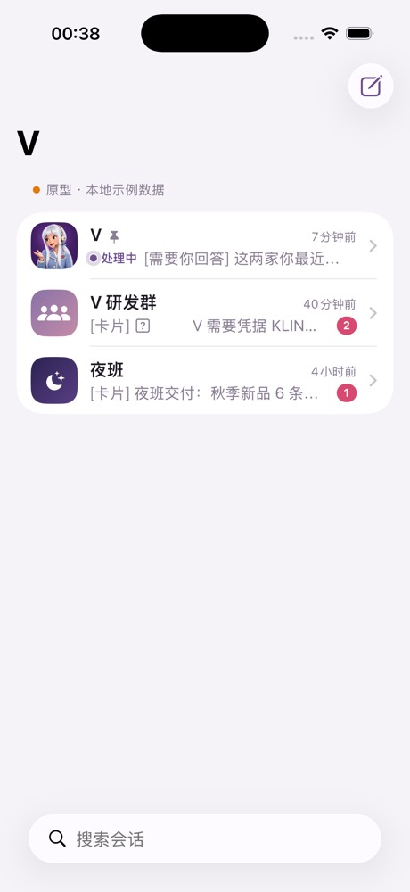
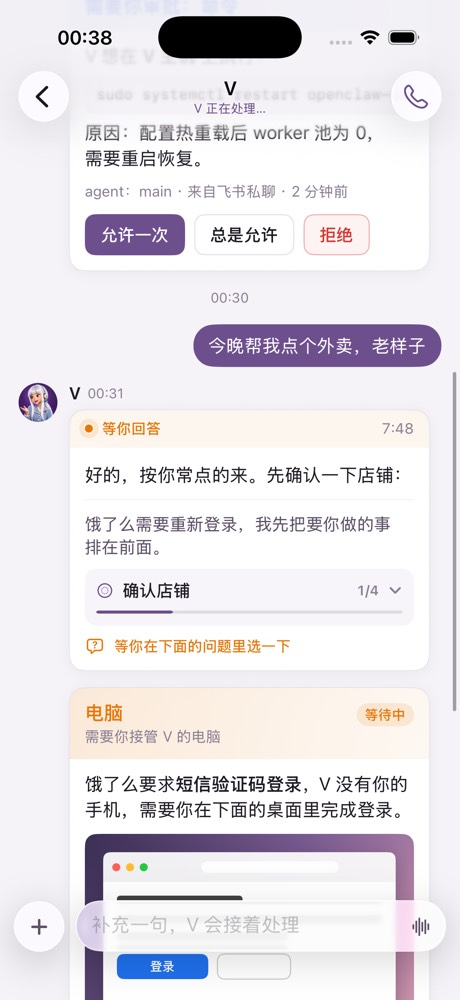
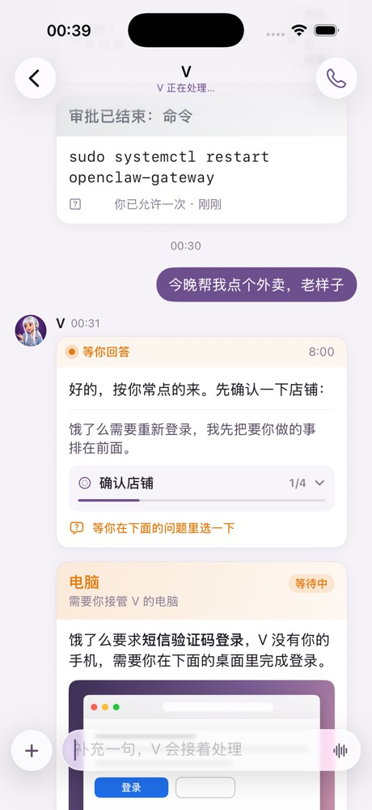
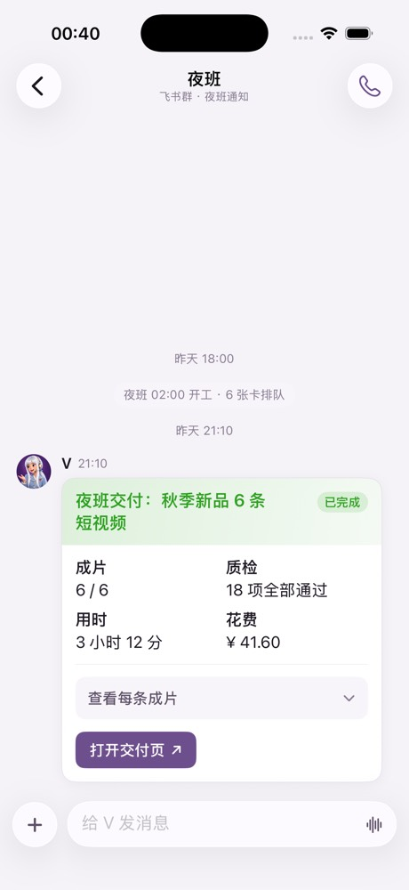
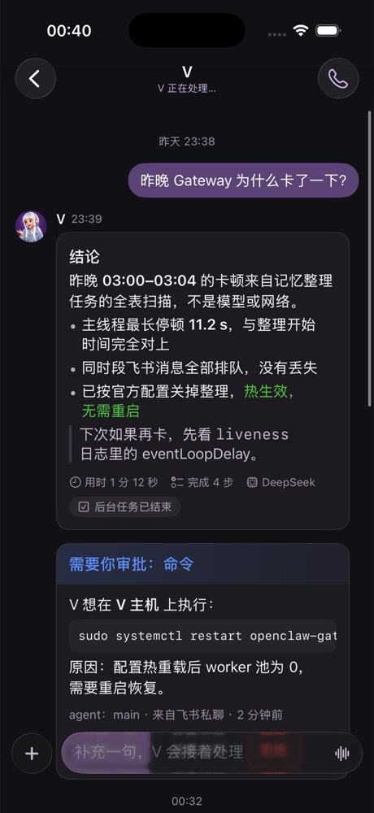

# V 客户端（iOS 原型）

和 V 文字对话的原生 App：会话列表、聊天，以及和飞书里一样的卡片——V 的工作卡、审批、「电脑」接管、凭据、`ask_user` 选择题、夜班交付。和 `ios/`（V Voice，一按通话）是两个 App；通话入口留给 V Voice。

状态：**界面原型**。所有数据来自本地示例（`FixtureTransport`），没有连接 V 的 Gateway，也没有调用模型。

    

## 参考了官方 App 的什么

参考的是 OpenClaw 官方 iOS App（`openclaw-versa/apps/ios`，MIT，本机副本是 2026-09-24 的）：

- 设计规则照搬它的 `DESIGN.md`：系统结构优先（`NavigationSplitView`、`List`、工具栏）；Liquid Glass 只用于输入栏这类可交互的控件，卡片和正文用不透明的安静背景；颜色只表达语义；支持深色和 iPad 双栏。
- 计划区沿用它 `ChatProgressCard` 的形式：收起时显示当前步骤和 `2/4`，点开看全部。
- 连接方式沿用它的路线：作为 operator 连 Gateway WebSocket（见下文第二阶段）。

没有直接依赖它的 `OpenClawKit`：那个包跟的是上游 9.x 协议（`progressCard.get`、`sessions.messages.subscribe` 等），V 生产还在 9.1，接口不一定都有；而且整个 App 会带上 GRDB、Watch 的 Rust 工具链。第二阶段只摘取连接和设备认证需要的部分，并按 V 的实际版本核对。

## 卡片：直接吃 V 发给飞书的 JSON

`FeishuCard` 解析飞书卡片 JSON（schema 2.0，兼容 1.0），覆盖 V 现在实际在发的元素：

| 元素 | 说明 |
|---|---|
| `header` | 标题、副标题、`template` 颜色、`text_tag_list` 标签 |
| `markdown` / `div` / `lark_md` | 段落、标题、列表、引用、代码块、分割线；飞书专有的 `<font color>`、`<text_tag>`、`<at>`、`<br>`；`text_size: notation` 灰色小字 |
| `button` | `primary` / `primary_filled` / `danger` / `default` / `text`；`open_url` 直接打开，`callback` 的 `value` 原样交回 V |
| `column_set` | 普通分栏；`flex_mode: flow` 按钮一行排开、放不下自动换行 |
| `div.fields` | 两列字段（夜班交付卡） |
| `img` | `img_key` 由 V 换成可下载的地址（飞书的 key 客户端读不到） |
| `collapsible_panel` | 可折叠段落 |
| 未知元素 | 显示一行「此卡片包含暂不支持的内容，请在飞书查看」，其余照常显示 |

审批卡的测试用例就是 V 飞书审批插件 `vFaCard` 产出的结构。这样服务端同一份卡片可以同时发给飞书和客户端，不用为客户端另写一套。

V 自己的工作卡（`WorkCardView`）不是飞书 JSON，而是由 Gateway 事件拼出来的原生视图，内容对齐飞书进度卡：答案逐段出现；处理中显示 💬 说明、计划、⚙️ 当前工具、❓ 等你回答、后台任务行；完成后只留答案和「用时 / 完成 N 步 / 模型」。

## 第二阶段：连上 V

1. **连接**：走 Control UI 已有的公网 HTTPS 入口，以 operator 身份连 Gateway WebSocket；设备身份用 Ed25519，首次连接走现有的设备配对审批；令牌存 Keychain。不新开公网端口。
2. **对话**：`sessions.list`、`chat.history`、`chat.send`、`chat.abort`；订阅 `chat`（delta/final）和 `agent`（plan / tool / assistant）事件拼工作卡；`question.get` / `question.resolve` 回答选择题。先在 VLab 核对 9.1 上每个方法和事件确实存在、字段一致。
3. **卡片同步（需要平台改动）**：现在审批卡、「电脑」卡、凭据卡是插件直接发到飞书的，Gateway 的会话记录里没有，客户端拿不到。需要在 `v-openclaw-platform` 另开 PR：插件发飞书卡片时，同时把同一份卡片 JSON 作为会话事件发出，按钮回调走和飞书卡片相同的处理函数。审批也可以直接用 Gateway 原生的审批接口。
4. **身份与权限**：会话可见范围和按钮权限由 Gateway 按配对的设备和 owner 判断，客户端不传、也不能自称 sessionKey 或用户身份。
5. **之后**：推送（APNs 需要中转）、图片/文件上传、iPad 键盘快捷键、从聊天直接拨 V Voice。

## 构建与测试

```bash
cd client && xcodegen generate
```

```bash
xcodebuild -project client/VClient.xcodeproj -scheme VClient -destination 'platform=iOS Simulator,name=iPhone 17 Pro' CODE_SIGNING_ALLOWED=NO test
```

- 最低 iOS 26，Swift 6 严格并发。工程由 `project.yml` 生成，生成出的 `VClient.xcodeproj` 一起提交（和 `ios/` 一致）。
- 启动时设环境变量 `VCLIENT_OPEN_SESSION=dm|dev|night` 可直接打开某个示例会话（截图用）。
- 示例卡片在 `VClient/Resources/Fixtures/`，单元测试保证它们全部能解析、没有不支持的元素。

## 已验证与未验证

已验证（2026-10-30，iPhone 17 Pro 模拟器，iOS 26.3）：构建通过；4 个单元测试通过；会话列表、三个示例会话、审批卡点击后变为「审批已结束」、发消息后工作卡从思考→计划/工具→逐段出字→完成的全过程、深色模式。

未验证：真机；iPad 双栏；没有连接任何 V 环境。模拟器里 emoji（✅、🔑）显示为方框，运行时里有 emoji 字体，疑为这台模拟器的显示问题，需在真机确认。
