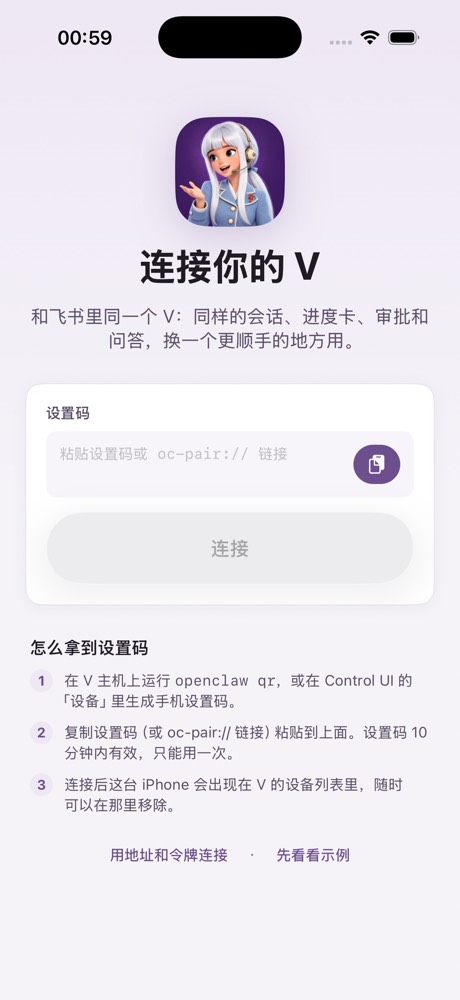
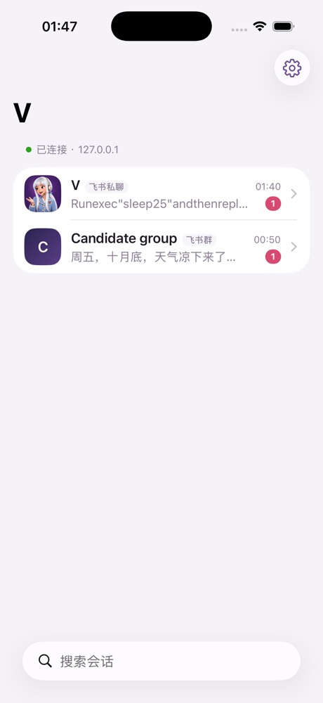
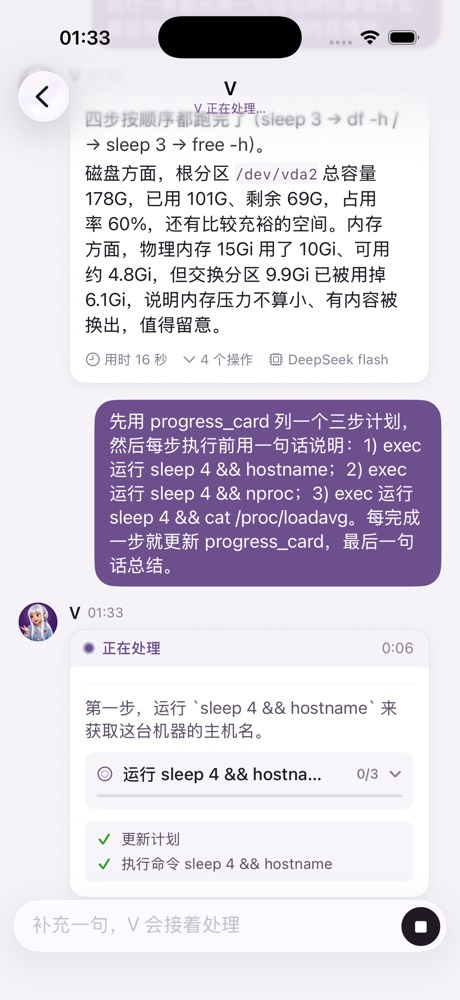
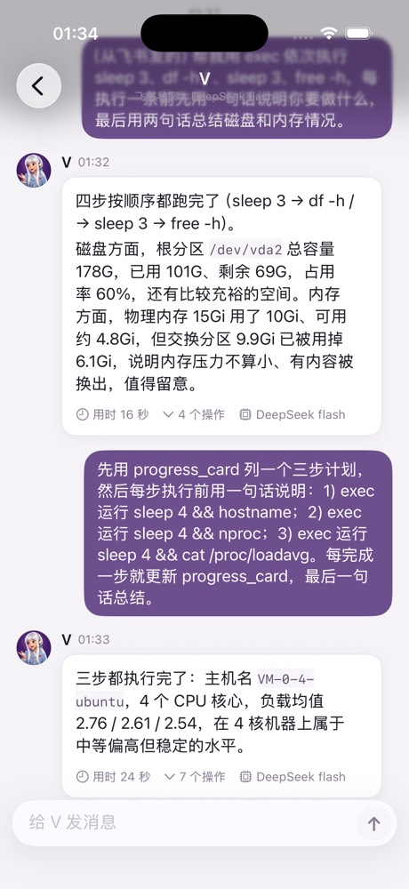
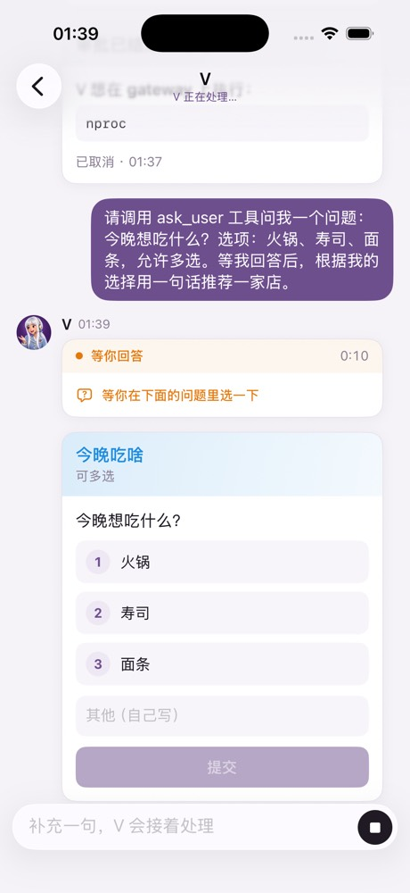
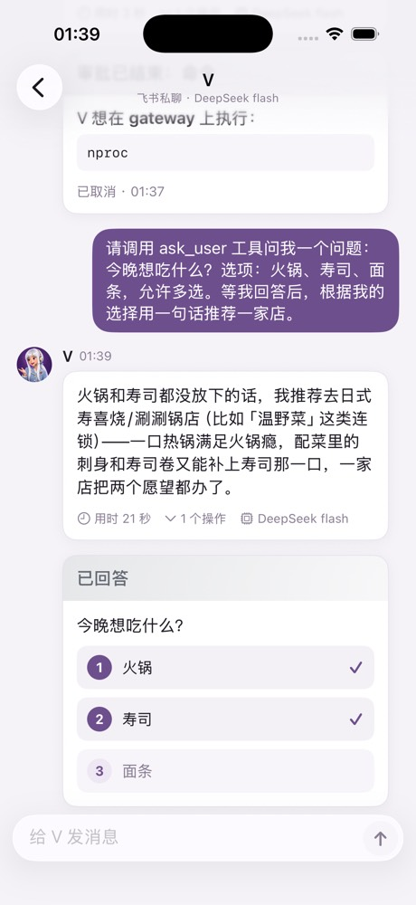
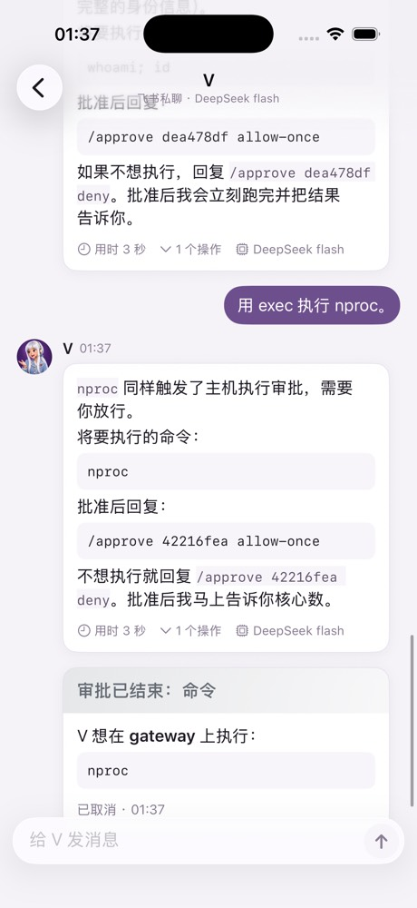
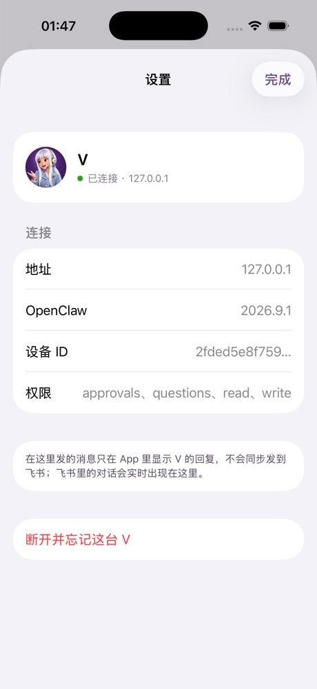

# V 客户端（iOS）

和 V 文字对话的原生 App：会话列表、聊天，以及和飞书一样的卡片——V 的工作卡（说明、计划、工具、后台）、命令审批、V 的提问、「电脑」接管、凭据、夜班交付。和 `ios/`（V Voice，一按通话）是两个 App。

状态：**已能连真实 V Gateway（9.1）**，在 VLab 私有 candidate Gateway 上端到端验证过；还没连过生产 V，没上过真机。

       

## 体验和飞书对齐的地方

| 飞书里 | App 里 | 数据来源（Gateway 9.1） |
|---|---|---|
| 私聊、群聊列表，未读、时间、预览 | 同一批会话，标题「V」/群名 + 「飞书私聊/飞书群」标签 | `sessions.list`、`sessions.changed` |
| V 的回复卡：答案逐段出现，下面 💬 说明、✅/▶️/◻️ 计划、⚙️ 当前工具 | 同一张工作卡：状态条（正在思考·连接模型 / 正在处理 / 等你回答）+ 计时，说明、计划（收起时显示当前步和 2/4）、最近 3 个操作 | `chat`（status/delta/final）、`agent`（tool、plan、item 的 preamble、run_status）、`progressCard.get` |
| 完成后卡片收起，只留答案 | 只留答案和「用时 · N 个操作 · 模型」，操作可展开 | 完成后用 `chat.history` 校正 |
| 飞书里发的消息、V 在飞书的回复 | 实时出现在 App 里（自己发的在右侧，群里其他人带名字在左侧） | `session.message`、`chat` 事件 |
| `ask_user` 问题：编号选项，回复数字 | 可点的选项、多选提交、「其他」自由填写、密码类输入 | `question.requested` / `question.resolve` |
| 审批卡：需要你审批：命令（允许一次/总是允许/拒绝），结束后变灰 | 同样的卡片和按钮，结束后灰色「审批已结束」 | `session.approval`（订阅时 `includeApprovals: true`）、`approval.resolve` |
| 插件发来的卡片（凭据、电脑接管、夜班交付） | `FeishuCard` 直接渲染飞书卡片 JSON 2.0 | 现在只在示例模式；见下文「还差什么」 |

另外：停止当前回合（`chat.abort`）、发送失败可点重发、断线自动重连（握手 10 秒超时重试，回前台立即重连）、长历史「查看更早的消息」、深色模式、iPad 双栏。

从 App 发的消息 **只在 App 里显示 V 的回复**（`chat.send` 带 `deliver: false`），不会往飞书群里推一条没有提问的回复；飞书里的对话照常实时同步到 App。

## 连接与配对

和官方 OpenClaw iOS App 同一套协议：WebSocket 协议 4，身份 `openclaw-ios` / `ui` / `operator`，权限 `operator.read/write/approvals/questions`（不要 admin）。

1. 设备身份是 Ed25519 密钥，设备 ID = 公钥 SHA-256；按 v3 签名串（`v3|deviceId|clientId|mode|role|scopes|signedAt|token|nonce|platform|deviceFamily`）回应 `connect.challenge`。
2. 首次配对用设置码：V 主机上 `openclaw qr`（或 Control UI「设备」）生成，粘贴或点 `oc-pair://` 链接。设置码里的一次性 bootstrap token 换成长期设备令牌，存在 Keychain（`AfterFirstUnlockThisDeviceOnly`）。也可以手填地址 + Gateway 令牌，再等管理员批准。
3. 只接受 `wss://`；`ws://` 只放行本机回环（开发时走 SSH 隧道）。
4. 设备令牌被吊销时自动清掉并提示重新配对。

## 在 VLab 上怎么测的

不碰共享 VLab 和生产 V：`v-openclaw-platform` 的 `lab/candidate/v-client-gateway.mjs` 在 VLab 主机上起一个私有 Gateway（真实模型 DeepSeek flash + Worker，假飞书），预置一个飞书私聊和一个飞书群，签发回环地址的设置码；Mac 用 `ssh -L <端口>:127.0.0.1:<端口>` 转发，模拟器连 `ws://127.0.0.1:<端口>`。

```bash
node /Users/tianyicai/vlab-dev/lab/vlab.mjs candidate --repo <platform worktree> --owner v-client-ios --plan <platform worktree>/lab/candidate/v-client-gateway.plan.json
```

运行中可以往 `/tmp/vclient-gateway/inject-<n>.json` 写 `{"chat":"dm"|"group","text":"…"}` 模拟飞书来消息；写 `/tmp/vclient-gateway/stop` 结束并清理。

2026-10-30 实测（iPhone 17 Pro 模拟器，iOS 26.3，Gateway 2026.9.1）：

- 设置码配对、拿到设备令牌、重启 App 用设备令牌直连。
- 会话列表、两个飞书会话的历史（含工具调用、模型、用时）。
- 从 App 发消息：思考 → 工具 → 逐段出字 → 完成，完成后自动校正。
- 「飞书」发来的任务在 App 里实时显示：说明、progress_card 计划 0/3 → 3/3、7 个操作、最终答案。
- V 调 `ask_user`：App 里多选火锅 + 寿司提交，V 按选择继续回答。
- 命令审批：打开 `ask: always` 后，App 收到审批卡并在结束后变灰。
- 停止：App 自己发起的回合可以停止（25 秒命令在第 12 秒被中止）；别的设备发起的回合按 9.1 规则不能停，App 给出说明。
- 14 个单元测试：卡片解析、设置码、v3 签名串与设备 ID、历史折叠、合并规则、会话标题、审批卡、工具文案。

## 还差什么

- **审批按钮没能端到端点通**：9.1 + Worker 在回合结束时就把命令审批取消（`cancelled / run-aborted`），审批只活 1–2 秒，飞书里也一样。App 的卡片和 `approval.resolve` 已接好，需要一个会等审批的回合才能验证。
- **插件卡片同步**：「电脑」接管、凭据、夜班交付等卡片是插件直接发给飞书的，Gateway 的会话事件里没有，App 拿不到。需要在 `v-openclaw-platform` 另开 PR，让插件发飞书卡片时也把同一份 JSON 作为会话事件发出，按钮回调走同一个处理函数。
- **后台任务行**（⏳ 后台 2 项进行中）：没接 `tasks` 事件。
- **生产 V**：要用 `openclaw qr` 生成指向公网入口（Control UI 的 HTTPS 地址）的设置码；连接后这台手机会出现在 V 的设备列表里。没有在生产上试过。
- 真机、推送、图片/文件收发、语音入口（拨 V Voice）都还没做。
- 模拟器里 emoji 显示为方框（运行时有 emoji 字体，疑为模拟器问题），需真机确认。

## 构建与测试

```bash
cd client && xcodegen generate
```

```bash
xcodebuild -project client/VClient.xcodeproj -scheme VClient -destination 'platform=iOS Simulator,name=iPhone 17 Pro' test
```

- 最低 iOS 26，Swift 6 严格并发；工程由 `project.yml` 生成并一起提交。
- 模拟器构建要签名（默认的本地签名即可），否则 Keychain 写不进去，配对信息存不住。
- 启动参数 `-demo` 直接进示例模式；环境变量 `VCLIENT_OPEN_SESSION=<会话 key 的一部分>` 启动后直接打开该会话。

## 代码结构

| 目录 | 内容 |
|---|---|
| `Gateway/` | `GatewayConnection`（握手、请求/事件、重连）、`DeviceIdentity`、`GatewayEndpoint`（设置码、Keychain）、`LiveTransport`（会话、历史、实时事件、审批、提问）、`HistoryMapper`、`ApprovalCards` |
| `Cards/` | 飞书卡片 JSON 解析与渲染、飞书 markdown、V 工作卡、提问卡 |
| `Chat/` | 会话列表、聊天页、输入栏 |
| `Model/` | 数据模型、`AppModel`、示例数据 `FixtureTransport` |
| `App/` | 入口、配对页、设置页 |
