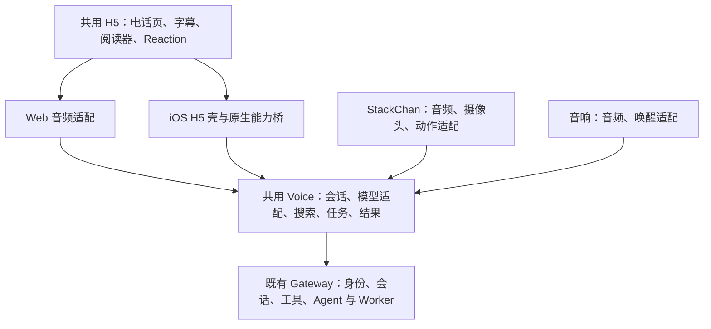

# V Voice 更新与接手指南

维护者：Tianyi、Codex、V。2026-10-26 整理，依据 10 月 21–26 日的主线、发布回执、用户验收和既有架构约定。本文是后续更新的工作入口；具体版本以 [生产登记](releases/current.json)、[iOS 版本登记](ios/versions.json) 和对应验收原文为准。旧文档中的 Candidate、未上线和未支持只描述当时状态，须沿后续发布记录核对。

## 1. 每次开工先做这六件事

1. 读取本仓库 `AGENTS.md` 和本文；恢复相关项目记忆，检查后续纠正。用户当次要求优先，已有授权不重复询问。
2. 核对 main、当前 worktree、未提交改动、实际运行提交、原生安装版本及回滚包；这些版本可能不同。复用适合的独立 worktree，不覆盖其他任务。
3. 写清这次用户路径、故障或目标，以及影响 Web、iOS、机器人、音响中的哪些端。
4. 先决定改动归属：**H5 → 共用 Voice 服务 → 必要的终端执行器 / 平台接口**。这是选择最小合理改动范围，不是绕过权限或强行把所有代码搬进网页。
5. 说明 Candidate 能覆盖什么，是否还需要共享 VLab、真实模型、真实手机或设备验收。缺少证据的格子写“未验”，不要填通过。
6. 先完成可审阅的代码、候选和回归，再报告准确 commit、PR、实际结果与未验项，按已有授权推进合入及发布。仅有开发请求不等于自动获准上线。

## 2. 更新放在哪一层

**优先更新 `v-voice`，尽量少动平台 V；优先通过 H5 和共用服务交付，减少 App 和固件升级。**

| 需求 | 首选归属 | 需要特别核对 |
| --- | --- | --- |
| 布局、字号、文案、Markdown、阅读器、普通动画、网页 Reaction、首页更新日志 | `lab/gpt-live-h5` 共用 H5 | 同步 iOS UI 包；网页与 App 同一套组件 |
| 自然接话、等待提示、多人事件解释、搜索、任务进度、结果归属、挂断后任务继续、模型适配 | `lab/realtime-direct-tools` 等共用 Voice 服务 | 四端行为矩阵；不按 phone/speaker 分叉产品策略 |
| 已有执行能力支持的播放参数、字幕/任务/报告投影、新 PCM relay 模型目录 | Voice 服务及有版本的能力桥 | 每通话固定策略快照，旧客户端兼容，参数有界 |
| AVAudioSession、采集/播放/AEC、WebRTC 驱动、Action Button、Keychain、权限、Widget 布局/编译资源 | iOS 原生执行器 | 新 binary、安装回读、真机验证；网页热更不能替代 |
| 麦克风/扬声器、唤醒、近场门、Opus/PCM、摄像头、舵机、固件协议 | 机器人/音响适配器或固件 | 保留现场输入策略；不为普通服务更新自动刷机 |
| Gateway RPC、Agent/工具授权、Worker、飞书会话核心、平台事件钩子 | `v-openclaw-platform` 独立 PR | 共享 VLab、lease、平台发布/回滚；不能在 Voice 复制或热改 runtime |

例如：改搜索时说什么，在共用服务改；改电话页账号排版，在 H5 改；修 Action Button 或原生播放队列，在 iOS 改。旧电话收藏跳转在 Voice 修；新群/新私聊自动创建菜单的 Feishu 事件钩子在平台修。本次入口更新因此拆成 Voice #148 与平台 #476，两者分别验收。

“少升级终端”不能变成下载任意代码、放宽能力桥校验、把原生后台音频交给 WK 页面，或让旧端假装支持新能力。底层执行器有问题就修执行器。详见 [原生能力桥](ios/NATIVE-CAPABILITY-BRIDGE.md) 和 [网页交付机制](ios/WEB-DELIVERY.md)。

## 3. 多端协同框架



这是职责图，不表示所有模型使用相同网络传输。GPT WebRTC 与小何/Grok relay 的实际链路、可用工具和能力协商须分别验证。

- 对话、搜索、后台任务、进度播报和结果交付由共享引擎决定。适配层只处理传输、硬件、播放回执、唤醒与展示能力；终端不同不应导致不同任务逻辑。
- Web/iOS 和上海机器人/音响由两个 Voice 节点服务；同一已验证 artifact 发布到两端。**同产物只证明版本一致，四端实际行为和硬件体验另验。**
- iOS 页面复用 H5，原生 `CallCoordinator` / 音频执行器拥有通话。页面重载、前后台切换不能新建通话、重复收音或夺走 owner。日常页面更新在空闲前台校验后生效，通话中固定页面版本，失败保留可用版本。
- 原生桥使用版本、call generation/owner、revision、操作白名单和有界参数；不要新增 Swift 的模型名/source/中文关键词分支来解释产品语义。
- 设备能力声明表示当前设备能做什么，不授予账号或工具权限。服务端绑定 actor、session、device 和当前 `voiceSessionId`；请求和回执按 request ID、通话、操作、期限校验。迟到、跨通话、重放回执不恢复已结束操作。
- 有副作用的设备操作若缺少完成证据应返回 `unknown`，不能自动重试。权限撤回、断连、换 owner、结束通话要使相关请求失效。模型“说做了”不等于设备执行成功。
- 设备能力框架存在，不代表所有端、模型和后端部署都已启用。还须核对实际协商、后端 bundle/preflight、安装版本和权限；未配置保持不可用。详见 [设备合同](capabilities/shared-device-contract.md)、[后端部署合同](capabilities/backend-device-deployment.md) 与 [集成证据](capabilities/20261025/integration-status.md)。

源代码入口：`lab/realtime-direct-tools/session.mjs`、`native-runtime.mjs`、`lookup-recovery.mjs`、`device-endpoint.mjs`，以及 `lib/terminal-context.mjs`、`lib/device-requests.mjs`。行为约定见 [共享终端行为](shared-terminal-behavior.md)。

## 4. 必须保持的 UI 与交互标准

### 同一套电话产品

- H5 是电话 UI 的来源，iOS 复用现有 DOM、样式、组件、Markdown 和 Reaction；不要为了原生外观再写一套通话页。原生设置和系统表面保留必要差异。
- 手机以 V 的头像/表情为主角，状态收敛为清楚的一行，当前对话紧随其后，通话控制保持容易触达；电脑保留头像与聊天区的分栏布局。复用现有色彩、字体层级、圆角与间距，不为每个功能新增独立设计系统。
- 打开入口首先看到熟悉的电话页和拨号按钮。飞书确认在原页完成：V 下方给一句简短指引，成功后原页更新姓名与会话。保留拨号主操作，不再用独立鉴权页面或大段技术说明替换电话首页。
- 人名、账号与会话分层表达。只展示已核验身份；账号或会话切换应清楚可见，不能悄悄改变正在进行的电话。Public、已连接账号/会话、设备与权限的展示按各端已发布版本实现，不能用服务发布冒充未安装的原生设置更新。
- 绑定/选择/移除用一致的轻量样式；保留原入口和当前选择。授权失败说明可执行的下一步，Public 恢复必须显式选择，不代用户重新拨号或转交未完成请求。

### 字幕、内容、任务与 Reaction

- 字幕流式更新同一条消息，稳定 ID、原始时间顺序和说话人归属；最终文本不要制造重复气泡。连续多人输入不能只保留最后一人。用户上翻阅读时不强拉到底。
- 长文、方案、表格、代码和媒体用原有阅读器与卡片，保留完整内容；提示、摘要或“已显示”不能替代实际交付。打开本通话结果不新拨电话，旧通话内容不能污染新通话。
- 任务状态来自真实阶段/结果，不编造进度。等待、插话与完成播报遵循共用服务的归属与时机；无屏幕设备不声称“已显示”。挂断与取消后台任务分别处理。
- Reaction 复用已审核资源，保留“人说什么 → V 回什么 → 实际显示什么”的可核对关系。selected 不等于 displayed；Reaction 不参与工具授权、任务决策或挂断路由，不为后台表情额外调用模型。
- 页面状态必须对应真实连接、收音、播放、静音、重连和失败。按钮禁用、错误与恢复路径不能仅靠颜色表达。验证小屏、横竖屏/桌面、长姓名、长内容、键盘、安全区和较大文字；检查控制不遮住内容。

### 灵动岛与锁屏

- 保留已选定的小/中/大交互。中、大展开以真实语音波形为主，Reaction 和必要控制可见；方案用入口进入 H5 全文，不擅自恢复已经被取代的大段字幕布局。
- 波形来自真实输入或实际播放游标对应的输出能量；静音、无声、过期快照必须正确反映，不能用循环假波形表示“正在说”。沿用当前实现的节流与数据预算。
- 系统提醒请求、组件预览、模拟器截图、真实手机自动展开是四种不同证据。专注模式等系统行为要先核实，不能凭“中卡没出现”就改音频或接通逻辑。
- Action Button、静音、结束、返回当前通话和方案入口复用同一个通话 owner。Widget 结构、资源和新系统能力需要原生发版，不能承诺网页可任意热更灵动岛。当前选择及历史纠正见 [灵动岛记录](ios/ISLAND.md)。

### UI 验收方式

网页优先在 Codex 右侧内置浏览器实际打开并操作；iOS 用独立模拟器配合 `ios-simulator-browser` / `serve-sim` 展示真实画面。需要 Chrome 登录态或项目专用测试时再选对应工具。截图说明页面、版本、入口与动作；设计图、DOM 断言和预览组件不能替代实际用户路径。

## 5. 身份、会话与入口不可混用

- 群/DM 动态入口必须由服务端把实际账号与会话交给 Gateway 核验；浏览器参数不能自报 `callerId`、`sessionKey` 或权限。固定私有入口仍按原服务端映射，不被当前浏览器账号替换。
- 未确认身份的 Public/访客使用其受限能力和自己的上下文，不继承来源群历史或 Tianyi 的个人工具身份。语音对话已开放，不等于个人权限开放。
- 同群不同账号分别绑定；每次新拨号创建新的 `voiceSessionId`，原 Feishu session、已有 App 绑定和历史报告保持其原归属。
- 维护范围包括**所有可操作的老群、老 DM，以及新群、新 DM 的自动入口**；仅修改默认生成代码不会自动修复旧菜单和历史收藏。群菜单、DM 页签、平台覆盖链接、旧书签、内部账号、外部联系人、App 绑定需分别检查。
- 飞书内部免登与外部联系人原页卡片确认是不同路径。卡片确认成功、网页进入、App 保存、工具权限与真实音频分别验，不能用其中一步代表全部。
- 批量迁移先盘点与 dry-run，逐项备份、只改可确认属于自己的链接、原位保留菜单 ID/顺序和其他字段，写后回读并保证重跑幂等。重复同名、未知域名、跨账号/会话、权限不足应停止该项，不扩权限凑覆盖率。
- 232024 等权限拒绝、已解散会话、历史缺少 chat ID 分开统计。不得为“全部修复”群发消息探测会话，也不能把不可读取当作不存在或成功。

当前入口事实与验收见 [身份确认发布](releases/feishu-confirm-20261025/release.md) 和 [旧入口发布](releases/entry-release-20261026/release.md)。

## 6. 先 Candidate，再按影响范围上线

**是，功能或行为变化先完成隔离 Candidate 验证；但并不是每次都要部署共享 VLab。** 纯文档更新做事实、链接和 diff 检查即可，不需要部署服务或制造音频测试。

| 改动影响 | 必需的候选/集成范围 |
| --- | --- |
| Voice 内部 UI、Markdown、头像、音频播放、模型适配、使用既有权限接口的入口映射 | 隔离 Candidate，真实 HTTP/WebSocket/渲染路径及相称回归；涉及体验再做已授权真实音频 |
| Gateway/Worker、工具或身份权限、会话核心、共享配置/数据迁移、跨服务协议 | 独立候选先测；再按平台流程取得共享 VLab lease，验证实际集成产物与对应授权路径 |
| iOS 原生执行器、系统入口或固件 | 候选构建/协议与系统测试，加相应真机安装和体验验收；涉及平台时再加共享 VLab |
| 混合变更 | 分 PR、明确依赖/顺序/回滚；各部分按实际影响覆盖，最终验证组合 |

测试从复现问题和相邻回归开始，不用镜像实现的空测试凑数量。发布必需检查见下一节。四端共用策略修改必须覆盖 Web/iOS/StackChan/speaker 的搜索、任务、进度、插话、结果矩阵；协议适配还需设备端点回归。模型差异不能被四端矩阵掩盖。

共享 VLab 的源码分支测试、安装目录和 Gateway 真正加载的模块必须对应。此次入口修复曾发现 Candidate 覆盖的 `openclaw/node_modules` 并非实际 Feishu npm generation 路径：修正到真实加载文件后才做 installed-module 回归。以后先确认加载路径与 hash，不能拿同名文件或 overlay 测试冒充运行产物验收。

共享 VLab 按平台当前 `lab/README.md` / `lab/AGENT-QUICKSTART.md` 执行，先查状态与占用、获取 lease，保留其他工作和配置，完成后还原自己的临时改动并释放 lease。本地离线通过、共享集成通过、ALIGNED、生产运行正常、真人体验接受是不同结论。

### 音频稳定基线

build 32 / `af6c0da` 是用户明确保留的连续播放与正常打断回归基线，不表示它仍是最新分发包。音频、VPIO、队列、打断、分类器、事件解释和调度修改按 [稳定基线要求](ios/stable-baseline-build32.md) 比较轻声短句、回声、持续播放与完整打断；保留包和同条件数据，不放宽门槛来获得通过。build 39 的接受也不自动取消这份基线。

真机音频验收注意屏幕共享曾造成麦克风全零；有上传帧不等于有效收音。模拟器合成 PCM、模型文本 fixture、健康检查、手机上出现页面均不能证明实际听感。真实拨号、付费模型、原始录音和刷机按当前明确授权执行，不自动扩大范围。

## 7. 正式发布和回滚

### Voice 日常发布

1. 发布前更新用户可见 `lab/gpt-live-h5/changelog.mjs` 的正式 `VOICE_UPDATES`、`CHANGELOG.md` 与版本登记。Candidate 项不能混入正式历史；文档指南变更不伪装成新产品功能发布。
2. H5 修改后运行 `npm run build:ui`，同步网页 `app-bundle.mjs` 和 iOS 共用 H5 资源，检查生成差异并一并提交。只有原生壳适配修改时可单独运行 `npm run build:ios-shell`。特别核对 `ios/VVoice/Resources/H5Shell/native-h5.js`、`source-manifest.json` 和 `lab/gpt-live-h5/ios-shell-release.json`；漏交生成物会使源码、包与 CI 不一致。网页 bundle 以内容 hash 更新缓存地址，身份入口与 API 始终不缓存。
3. 通过相称测试以及发布必需检查：

   ```sh
   npm run check:ios-shell
   npm test
   npm run test:speaker-native
   python3 -m unittest discover -s tests -p 'release_fleet_test.py'
   ```

4. 按授权通过 PR 合入 `v-voice/main`，确认合入提交的 CI，通过后从干净的已合入源码打包并验证。未合入分支只能作 Candidate。README/文档提交与当前生产 commit 不必相同。
5. 用唯一发布入口 `scripts/release-fleet.py`，按 [统一发布流程](unified-release.md) 同时覆盖 web/iOS 与上海 devices。核对原服务身份、私有配置、Gateway 基线和活动工作，由原子 hold 保护通话/建连/后台交付；忙碌端记 pending 并等待，不强杀或只报完成的一端。
6. 两节点实际 commit、filesSha256、ready、hold 和 iOS UI revision 验证后，再检查正式 HTTPS 资源与浏览器用户路径；打开首页更新日志核对实际展示。相关真人/设备验收单列。
7. 更新 `docs/releases/<release>/` 与 `docs/releases/current.json`，保留旧 artifact、启动参数、私有环境和回滚回执。失败回滚同样要保护新版本已接入的通话，不删除绑定或业务数据。

### 只有平台改动才走平台发布

Voice 发布本身不重启 Gateway。平台改动单独按平台 PR、指定 dev 合入授权、共享 VLab、accept/promote、捕获归档/漂移检查、对齐与回滚流程执行。需要激活平台变更时使用规定的 `v-self-restart` 空闲保护与就绪验证；本次授权中的必要重启不重复询问。不能把一次平台重启授权扩展为以后日常 Voice 更新都重启 V。

生产平台只用 `ssh v` 的 Tailscale IPv6；别名失败先排查连接/身份，不回退公网。运行组件的 hash、配置、streams/workers 和实际链路都要核对；ALIGNED 只证明所比较产物对齐，不独立证明语音或工具功能可用。平台归档、tag 和 Voice 版本登记各记各的版本。

### 原生与固件单独登记

需要原生升级时，记录源码、build、签名 archive/IPA hash、安装回读、用户绑定保留和实际验收；测试包上传、Apple 处理、内部可测、外测审核、外测可安装分别记录。公开 TestFlight 链接存在不代表审核已过。固件同样记录具体设备版本与实体结果；只发布服务时不重装 App、不刷设备。

## 8. 最近几天形成这些规则的实际更新

以下是有日期的复盘，不是永远不变的“当前版本”。

| 时间 | 更新与经验 | 后续要坚持的规则/证据 |
| --- | --- | --- |
| 10/21 | 移动电话收音、恢复、自然接话与请求连续性 | [发布记录](releases/voice-mobile-turn-20261021/README.md)；浏览器可拨号与真实手机音频分验 |
| 10/22 | H5 页面复用、网页资源更新、字幕连续性与灵动岛整合 | [网页交付](ios/WEB-DELIVERY.md)、[字幕修复](ios/CAPTION-CONTINUITY.md)；一次更新要核对网页、生成包和已安装壳兼容 |
| 10/23 | 原生能力桥、自然查询接话、群/DM 通话与绑定 | [能力桥](ios/NATIVE-CAPABILITY-BRIDGE.md)、[原生运行发布](releases/voice-native-runtime-20261023/README.md)；内容/策略上移服务，硬件执行留原生 |
| 10/24 | build 32 稳定基线、四端行为统一、安静拨号与入口身份 | [基线](ios/stable-baseline-build32.md)、[共享终端](shared-terminal-behavior.md)、[入口发布](releases/unified-entry-20261024/acceptance.md)；不破坏打断，不为终端复制任务策略 |
| 10/25 | build 39、Public 与绑定体验；内外部飞书账号原页确认 | [build 39 登记](releases/ios-testflight39-20261025/release.json)、[确认发布](releases/feishu-confirm-20261025/release.md)；真人接受、外测审批与服务部署分别记 |
| 10/26 | 老群/DM 菜单、旧书签与新入口自动化闭环 | [入口发布](releases/entry-release-20261026/release.md)；421 群+56 DM 已核验，4 权限拒绝、1 已解散、13 历史用户缺 chat ID 保留例外 |

写本文时生产登记为 `entry-release-20261026`，Voice 双节点运行 `9ae49f5`，平台入口修复 #476 已激活并完成 VLab/V 对齐。最近原生登记为 build 39 已获 Tianyi 内测接受；10/25 最后核验仍等 Apple 外测审核，本文不重新声明审核实时状态。更新指南本身不部署服务，不重启 V，也不改变原生/固件版本。

## 9. V / Codex 接手与记忆维护

接手先读本指南和 current.json，再沿相关专题读实际源码、最新发布回执及未完成项。不要根据旧记忆里的候选标题推断今天的生产状态；遇到矛盾保留旧结论为历史，并补上带日期的纠正和证据。

每次交接使用以下短模板：

```text
目标与用户路径：
改动归属 / 为什么无需或需要平台、终端升级：
源码仓库、分支、准确 commit、PR：
Candidate 环境 / 产物与测试 / 真实模型、设备验收：
共享 VLab 是否需要、实际结果与 lease 清理：
已获授权与下一步动作：
生产两节点实际 commit/hash、iOS UI revision：
原生/固件实际安装版本及未验项：
首页日志 / 版本登记 / 回滚位置：
遗留问题、权限例外与复验条件：
```

GitHub 本文是完整流程的维护入口，`AGENTS.md` 和 README 指向它；记忆保存高信号规则、主文链接、日期与版本，避免多份长文各自漂移。用户授权记忆更新时，Codex 原生记忆只写规定的 ad_hoc 更新入口，Universal Memory 只写自己的 contributor namespace；V 更新自己的项目记忆和入口索引。同步消息必须拿到发送回执，V 是否已阅读/记入须另有回复或回读证据。

本次用户明确授权将指南放入 GitHub 和双方记忆；这项文档交接不授予未来任意生产发布、付费测试或对外消息权限。后续更新遵循当次人类授权及项目规则，不因“指南说可以”越过实际任务范围。
