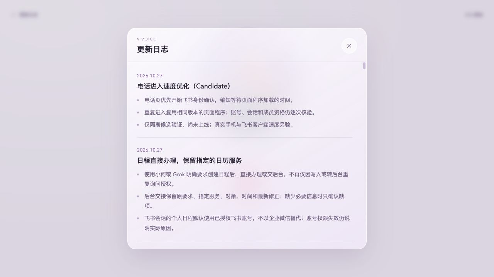

# 电话进入延迟 Candidate

版本 `voice-entry-latency.20261027.1`，分支 `codex/voice-entry-latency-20261027`，基线 `002313b`。未合入、未部署。测量终点是进入电话页后**可以拨号**，不包含点击拨号、麦克风、通话接通或首音。

## 现场与归因

2026-10-27 fetch 后 main 为 `002313b`，生产登记与 web 节点现场运行目录为 `7ce20a2de22bedba1cc32086d5f832a44539cd8c`；双节点产物事实沿用 [#155 发布回执](../../releases/calendar-consent-20261027/verification.json)，本次没有重验或操作 devices 节点。GPT Live 的 Gateway 插件仍不能由 Voice 源码存在推断已激活。

只读汇总 10/26 起既有生产计时 25 条：identified 11 条，进入到可拨号中位数 5415ms（3013–9415），SDK 开始中位数 3032ms；guest 14 条，中位数 2783.5ms（1416–12257）。其中 9 条 identified 记录会话核验中位数 744ms（556–2325），授权码交换 213ms（201–241）。记录没有设备、网络、冷/热缓存和来源标签，且有采样限流，不能当作手机 SLO 或稳定用户分布。原始生产日志、账号与入口没有复制进仓库。

主要可控等待发生在身份 SDK **开始之前**。原页预加载几十份 UI/音频/头像模块，身份启动依赖的 `feishu-client-login.mjs` 没有提前预加载；网页程序统一 no-store，重访继续下载并处理模块图。SDK 文件加载后至 ready 通常很短；会话核验、授权码交换仍有独立等待。静态资源不携带 phone 参数，不会逐份调用动态账号准入，已排除此初步猜测。原有 SDK 内入口到已登记 callback 的一次重定向、失败回退、外部浏览器确认与 OAuth 回跳均保留。

## 改动与范围

- 用已有 esbuild 预构建网页 `app-bundle.mjs`，保留 `app.js` 作为拥有逻辑的源码；独立 `entry-startup.mjs` 仍最先处理身份/status，bundle 直接复用它的同一个 promise。
- 优先预加载 entry 与 SDK 适配模块，电话引擎只加载一个 bundle。bundle URL 带服务端计算的内容 hash；仅匹配该 hash 的无用户数据程序代码可在浏览器私有缓存中长期复用。新 artifact 自动换 URL，旧/缺失 hash 不获得 immutable 缓存。
- HTML/内联账号、SDK 身份交换、status、其他 API 继续 no-store。每次打开与 API 请求保留原 Gateway 准入；不缓存身份或 membership、不延长登录、不提前授予旧账号可拨号权限。
- `build:ui` 同步网页 bundle 与 iOS H5 生成资源；构建一致性测试阻止漏交旧 bundle，package 明确包含新文件。候选首页日志与 CHANGELOG 已记录，生产 current.json 和正式首页历史保持原版本。

只改 Voice 内部资源交付，沿用全部既有权限与协议，因此使用隔离 Candidate，无需占用共享 VLab。未改 Gateway、Worker、身份签名或会话核心；没有修改语音模型列表。

## 浏览器对照

Codex 右侧内置浏览器，桌面 1280×720，真实 HTTP/渲染/交互；Mac 本地 HTTP/1.1 代理固定每请求等待 150ms，模拟 Gateway 准入 550ms、飞书 API 200ms、SDK 回码/拒绝 500ms。无吞吐限速，无真实飞书、Gateway 或模型请求。内存中的应用 token/群标题缓存已预热；下表每条路径前后各 3 次，除首次空缓存页面样本外程序缓存沿用之前导航，SDK 首访表示**无账号登录态**，不意味着每次程序缓存全冷。小样本只报告中位数，不报告 P95。

原始脱敏计时：[samples.json](samples.json)。FCP 为首个内容绘制；identified SDK 路径的身份就绪取 login.complete，基本等于可拨号。已登录外部浏览器的身份已在响应中核验，因此就绪时间不晚于 TTFB，不伪造独立浏览器确认事件。

| 路径 | FCP 前→后 ms | 可拨号前→后 ms | 减少 |
| --- | ---: | ---: | ---: |
| 外部浏览器首访，未连接账号/显示访客 | 288→272 | 1080.5→386.2 | 64% |
| 外部浏览器已登录重访 | 800→776 | 1535.2→882.9 | 42% |
| 飞书内部 SDK 首次身份 | 492→444 | 2680.0→1964.3 | 27% |
| 飞书内部 SDK 已登录重访 | 428→396 | 2583.2→1929.6 | 25% |
| 卡片确认账号在飞书内重访，SDK 拒绝后恢复 | 476→488 | 2410.2→1795.4 | 26% |

完整冷程序缓存的 SDK 首访另用全新 origin 各测 1 次：基线 TTFB/FCP/SDK 开始/身份就绪/可拨号为 361.7/492/1205.3/2616.3/2617.0ms；候选为 393.4/500/617.2/2028.2/2029.3ms。约减少 588ms。首屏绘制变化很小，改善主要来自更早开始身份识别和更快完成主程序加载。

外部浏览器首次卡片路径前后都实际操作了“连接飞书身份”，本地模拟卡片与验签回调后原页显示测试账号和群，会话仍未创建。真人回飞书点击卡片的用时不纳入上述 SDK/重访数字，本次没有真实卡片投递或真人确认耗时结论。

已绑定设备凭证的网页 HTTP 路径前后各 3 次也通过：可拨号中位数 1572.1→978.8ms，见 [device-grant-http.json](device-grant-http.json)。这是设备 grant 进入**网页**的合同验证，不能冒充原生 iOS App 速度。原生 App 已使用打包 H5，通过 BindingStore 的 status/过期后 access 恢复、CallCoordinator.refreshOptions 查询状态，不加载此次网页主模块图；本次不改其恢复顺序，也没有原生/真机计时。

## 验证与限制

| 检查 | 结果 |
| --- | --- |
| 页面 URL/标题、非空首屏、无框架错误层 | 通过 |
| 候选页面 console error/warn | 0 |
| 账号设置→Public | 显示独立访客，不残留已连接账号 |
| 连接飞书身份→模拟卡片→原页账号/会话 | 通过，无真实卡片和拨号 |
| 首页候选日志 | 实际打开并截图，未混入正式历史 |
| 账号切换、SDK 新账号替代、显式重连与迟到请求 | 原 HTTP 回归通过 |
| 撤销、原 30 天过期、成员资格重核、跨浏览器/Public/未知来电者隔离 | 原回归及新增缓存后撤权回归通过 |
| 程序缓存/新版本 URL/缺失或错误 hash、不缓存账号状态 | 新增真实 HTTP 回归通过 |
| check:ios-shell / Voice / speaker / release control | 通过；971 / 95 / 11 项 |

本次优化不消除 Gateway/飞书慢请求，也不改 SDK 既有超时。真实内外部飞书客户端、手机网络冷/热访问、原生 App、后台、麦克风/打断/首音仍未验。不得用本表宣称生产手机已达 2–3 秒；需要本次独立发布授权后再做相同设备/网络验收。

复现：`npm ci --ignore-scripts && npm run build:ui`，运行 `node scripts/candidate/entry-latency.mjs /absolute/source/root 28732`，在内置浏览器打开 `http://127.0.0.1:28732/`。模拟页面仅绑定 loopback，所有 provider/Gateway 均为本地函数，reserve 会抛错阻止通话。基线可用 `git archive 002313b` 导出到独立临时目录，复用安装依赖后用另一端口启动同一脚本；新端口用于完全冷程序缓存。运行不接触真实私有配置。

