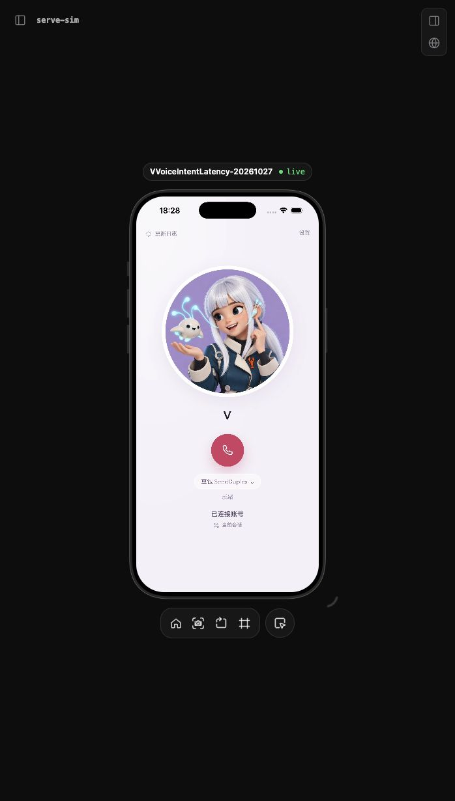

# iOS 首个呼叫反馈 Candidate

版本 `voice-ios-intent-feedback.20261027.1`，基于 `70ea3e1`，分支 `codex/ios-intent-feedback-20261027`。未合入、未分发、未安装实体机。用户澄清约 5 秒是**长按到出现灵动岛或呼叫界面**，不是网页进入后到可拨号，也不是接通/首音。

## 身份验证与首个界面分开处理

已有 iOS 绑定使用设备 grant 和 Keychain；不会每次走飞书 SDK/OAuth 或重新兑换一次性链接。`VoiceAPI` 在凭证失效且没有活动 owner 时恢复授权；设备撤销、账号切换、过期仍受服务端控制。当前动态飞书入口的会话准入由 Gateway actor-scoped 接口决定，私有 URL/设备绑定不替代当前权限。

可以复用身份凭证，将准入收敛到建连，并避免无意义的重复检查。服务端同请求去重由独立 [PR #169](https://github.com/vegekyd-sys/v-voice/pull/169) 负责；本 PR 不缓存成员权限、不改变 Gateway 或共享协议，不依赖 #169 即可验证。跨请求/跨通话缓存准入和重构通话中的重复验证是更大的服务端范围，不在本次原生修复中暗改。

源码中，已绑定且权限准备完成的来电先 `beginActivity`，随后才进行服务端拨号。因此首界面前约 5 秒不能直接归因于后台成员资格查询。首次权限/没有绑定/需要 Public 准备是另外的路径。这里检查的是当前源码，实际手机安装包及系统快捷指令路径尚未回读确认，不以源码替代手机现场。

## 原生改动

1. 旧灵动岛清理改为捕获旧活动快照后独立完成，正常启动不 await 旧活动结束。新 activity 不在旧快照里，不会被清理任务误结束。若 ActivityKit 明确返回 global/target maximum exceeded，仍等待自己的清理后仅重试一次；其他错误保留 Live Activity 失败结果，不重复创建通话。
2. App 不在同步初始化和每次 scene 激活时重复刷新快捷指令元数据。现有三个 App Shortcut 均为静态声明；首次前台场景渲染后等待 500ms，并在仍空闲时每进程刷新一次，后台 Action Button 启动不承担这项工作。Intent 名称、参数和系统模式未改，构建后的 AppIntents metadata 仍包含 TalkToVIntent。真实系统快捷指令发现/调用仍待验。
3. 生命周期诊断通过串行 utility queue 写 JSON，保留最后 512 条。事件时间和 monotonic uptime 在调用点捕获，避免文件读写阻塞主线程。只增加启动阶段名/耗时，不记录入口、凭证、会话 ID、音频、正文或坐标。测试删除 fixture 诊断前等待队列排空，避免迟到写入污染断言。
4. 记录 App 初始化、Coordinator 初始化、Intent 进入/准备完成、ActivityKit 请求/创建、旧活动清理和快捷指令刷新。`island.request.created` 是系统返回成功，不代表屏幕已绘制；App 代码开始前的 OS/快捷指令调度需要手机实际记录。

API 背景：[Apple 的 LiveActivityIntent 进程说明](https://developer.apple.com/documentation/widgetkit/adding-interactivity-to-widgets-and-live-activities) 表明此类 Intent 在 App 进程执行；因此进程启动与 Intent 内工作须分别定位。[快捷指令官方示例](https://developer.apple.com/documentation/appintents/acceleratingappinteractionswithappintents/) 在 App init 注册，本候选基于本 App 只有静态快捷指令，改为首次空闲前台延后刷新；这是需要真实快捷指令回归的取舍，不当作 Apple 保证无差异。

## 验证

本聊天专用 iPhone 17 Pro / iOS 26.5 模拟器，Debug arm64。构建、安装、启动通过，serve-sim 的真实画面已在 Codex 右侧打开并确认 live，截图仅含本地 fixture。网络只连接独立 loopback fixture 端口 29871/29872，无真实模型、飞书消息或物理录音。

- 新增模拟冷 Intent 回归：保留旧活动清理的 continuation 不完成，网络 session 延迟 1200ms；先观察新 owner 对应的 Activity 内容为 connecting，再释放清理。一次净样本约 **307ms** 已可观测到新活动状态，阈值维持 <1000ms；这不是实体 Action Button 按下到可见像素的测量，也不是从真实 5 秒降低到 0.3 秒的证明。见 [startup-feedback.json](startup-feedback.json)。
- 原生 77 项相邻回归通过；最终收紧错误重试条件后，启动/绑定相关 19 项再次通过。覆盖原生单连接、旧客户端、Keychain、切账号、凭证恢复、失效保护、静音、挂断、重连、字幕、报告和共享 duplex fixture。
- Core 45 项、Voice HTTP/共享 session 127 项通过，check:ios-shell 与 diff check 通过。见 [validation.json](validation.json)。
- 77 项模拟器回归中出现 16 条 QoS priority inversion 运行警告，涉及 fixture 准备和部分网络/音频测试；最终 19 项没有该警告。没有把警告直接归因为用户 5 秒的根因，也没有以通过断言宣称真实性能合格。

本轮相对 main 的 VoiceAudio、RelayTransport、GPTLiveTransport、VVoiceCore 与 Widget 文件逐字未变；调用前调度调整仍需按 [build 32 稳定基线](../../ios/stable-baseline-build32.md) 做实际声音/打断验证，不能仅由模拟测试替代。

## 发布与待验

这是原生系统启动/执行器改动，需要新的 App binary；网页热更和 Voice 双节点发布不能交付这部分。没有覆盖 build 32 回滚材料，没有变更 Gateway、线上绑定、服务配置或现有设备安装。未发布，因此正式首页已发布日志及正式 iOS 版本登记保留既有事实；原生发版前需按更新指南补齐实际 build、首页日志、签名包/安装与回滚登记。

仍需同一手机核对：实际已安装 build、操作按钮绑定的系统动作/快捷指令步骤、冷/热启动与锁屏、手势开始至 app.init / intent.talk.begin / ActivityKit created / 屏幕出现的分段；以及原有快捷指令发现、后台录音窗口、连续播放和打断。当前不能承诺用户的约 5 秒已解决。

