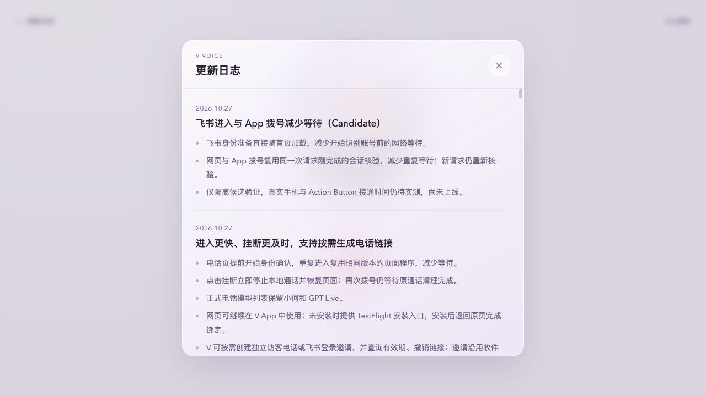

# 继续减少飞书进入与 Action Button 拨号等待

候选 `voice-startup-latency.20261027.1`，基于 `70ea3e1`。用户反馈飞书进入和 iOS Action Button 约需 5 秒。此次在上一轮已交付网页模块优化基础上继续处理，未合入或上线。

## 当前事实与计时边界

最新 main 登记 PR #160 已随 #167 发布，两个 Voice 节点版本为 `b4ed555`。本次通过 `ssh v` 只读核对 web 运行目录和 active 状态一致，未操作设备节点或 Gateway。发布后既有遥测 6 条 identified 进入记录为 6066、4130、3804、4967、2617、3505ms：仍有接近 5 秒的记录，先前模拟 2 秒不能代表手机体验。

这 6 条的 SDK 开始为 769–2898ms，SDK ready 后回码约 479–723ms，授权码交换 234–453ms，会话准入/名称查询为 556–1530ms。来源无设备/网络标签，样本少且有限流，不能作为同条件前后对照或真人分位数。没有保存原始生产日志、账号、会话标识或入口。

分别定义：

- 飞书进入：点击现有入口 → 页面首绘 → SDK 开始 → 身份就绪 → 可拨号，不创建通话。
- Action Button：原生 Intent 执行 → 音频执行器启动 → 恢复旧 owner → 单连接/历史拨号 → 取得 reservation → 工具/上下文/账号只读能力准备 → provider ready → 真实提示/首音。用户体感终点还需结合实际手机确认，不能混成网页进入。

## 已实施的最小改动

1. 独立身份 bootstrap 约 5.5KB，随 no-store HTML 直接交付，移除开始识别前的两份外部模块依赖。主通话 bundle 同样自包含，通过当前 document 的 Symbol promise 复用已开始的入口请求，不重复执行 SDK 或身份交换。新页面仍重新开始；账号切换/Public、过期、撤销逻辑不变。
2. 解析动态飞书入口已调用 Gateway actor-scoped resolve。原 HTTP session 和 native WebSocket 拨号在同一请求中又做一次完全相同的 resolve。现在仅消费服务端 WeakMap 中**同一个 IncomingMessage、同一个 binding 对象**的刚完成解析；解析完成后已超过 1 秒的请求重新核验，消费后删除。没有跨请求复用，静态私有入口仍执行原 exact-session 检查；未知来电者继续原隔离访客路径。
3. build/源码一致性测试、发布 package 明确包含 `entry-bootstrap.js`。首页仅新增候选说明，未修改正式已发布记录。公开 HTTPS 与 backend 响应都已只读核对没有 CSP 阻止该内联 module，未调整安全响应头或平台配置。

这些是 Voice 内部交付和同请求去重，既有 Gateway 接口、签名、actor 策略和权限保持，无跨服务协议变化；使用隔离 Candidate，不占用共享 VLab。Swift/原生音频/Action Button 实现和固件均未改，因此可随 Voice 发布交付，不需要仅为这两项改动重装 App。新原生二进制、模拟器音频和真机接受不由本次服务协议测试替代。

## 实测结果

Codex 右侧内置浏览器 1280×720，真实候选 HTTP/HTML/渲染路径。所有 SDK、飞书 API、Gateway 都是本地模拟。token 与标题缓存预热，SDK 回码 500ms，provider HTTP 200ms，Gateway 每次 550ms；每种环境前后各 3 次，首个 origin 缓存冷、之后程序缓存热，不以小样本报告 P95。原始样本见 [browser-samples.json](browser-samples.json)。

| 代理每请求额外等待 | 可拨号中位数前→后 | HTML 响应至 SDK 开始中位数前→后 |
| --- | ---: | ---: |
| 150ms | 1972.9→1889.5ms | 217.2→69.6ms |
| 500ms | 3346.8→2826.3ms | 542.6→22.9ms |

500ms 组首绘中位数 1116→1104ms，身份就绪约 3346→2826ms。变化主要是更早开始身份准备，未通过提前显示“可拨号”掩盖尚未完成的授权。浏览器页面/标题、非空首屏、无错误层、console（0 error/warn）、账号设置→Public 独立访客及候选日志均通过。没有点击真实拨号或发送真实确认卡。

另外用实际设备 grant 的服务端 WebSocket 合同做前后各 5 次 fixture（不运行 iOS 系统 Intent，不连接模型/音频）：

| 服务端阶段 | 基线 | 候选 |
| --- | ---: | ---: |
| 单请求 membership resolve 次数 | 2 | 1 |
| 握手至 reservation 中位数 | 1104ms | 553ms |

见 [native-admission-samples.json](native-admission-samples.json)。这是省去一次 550ms 模拟 Gateway 往返的直接证据，**不是 Action Button 到提示音从 1.1 秒降至 0.55 秒**。实际手机仍有调度、网络、上下文、工具目录、分账号核验、provider 连接与音频就绪等待。

## 权限与失败回归

- HTTP 与 native WebSocket 新请求逐次准入；同请求只复用自己的服务器对象，浏览器字段不提供证明。
- 下一次请求即使立刻到来也重新 resolve；成员资格撤回后不能保留原账号工具身份。已有浏览器访客 cookie 的撤权路径沿用独立访客降级，不扩大原权限。
- 请求头解析后延迟 1200ms 才送请求体，期间撤权：重新 resolve 并拒绝账号 reservation。
- bootstrap 与迟到主 bundle 不重复交换身份，旧请求/明确重连/新 SDK 账号替换、Public、30 天过期、跨浏览器与设备 grant 撤销继续原回归。
- Voice 1005/1005、speaker 95/95、发布控制 11/11、check:ios-shell 通过。没有改动音频实现或放宽 build 32 的声音/打断基线。

## 复现和剩余工作

运行 `npm ci --ignore-scripts && npm run build:ui`，然后 `VOICE_ENTRY_FIXTURE_REQUEST_MS=500 node scripts/candidate/entry-latency.mjs /absolute/source/root 28744`，在内置浏览器打开 launcher 的 sdk-first。基线导出 `git archive 70ea3e1` 到独立临时目录并使用另一端口。原生合同基准使用同一个脚本加 `--dial-benchmark`；该显式模式仅产生内存 mock reservation，默认浏览器模式会拒绝创建通话。

真实飞书客户端、同一 iPhone/网络前后对照、物理 Action Button、接通提示、首音、连续播放/打断仍未验。没有正在运行的模拟器，本次没有启动或占用其他聊天的设备；由于没有 Swift/音频实现变化，此轮以共享服务 HTTP/WebSocket 合同验证，不能报告模拟器/真机通过。

这两项优化可减少已定位等待，仍不足以承诺所有真实手机进入/接通在 2–3 秒内。需要本次 PR 的独立合入和发布授权，之后由同一手机同一网络取得分段诊断；如剩余瓶颈在 Gateway/member 查询、工具目录或上下文加载，再按实际拥有层单独处理，不能以缓存旧账号权限换速度。

