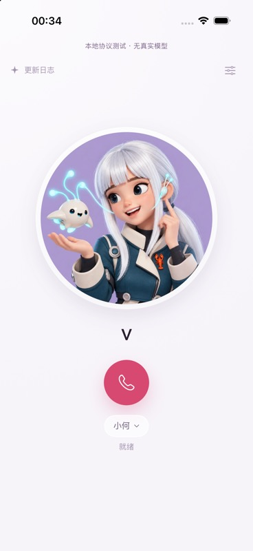
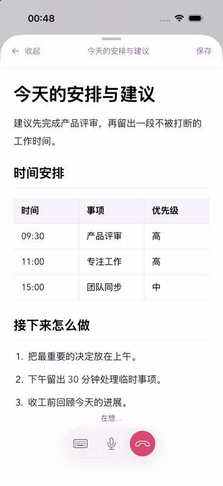
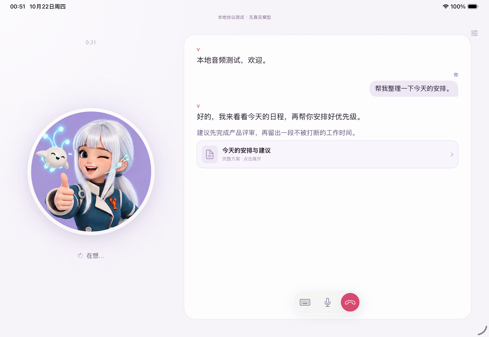
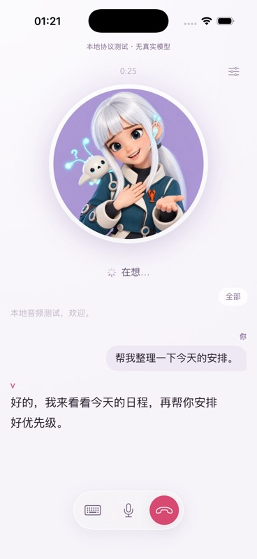
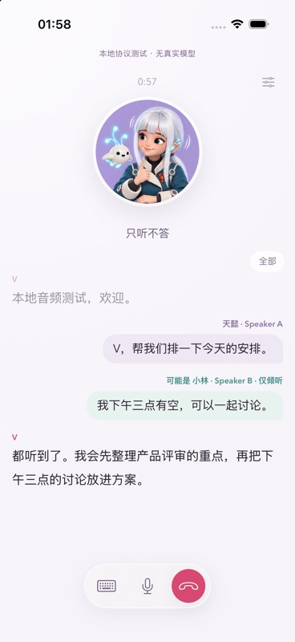
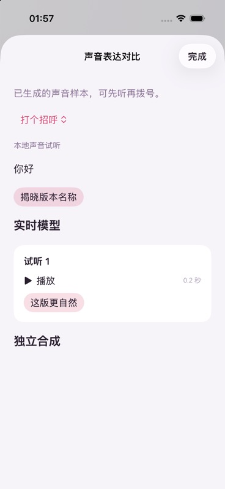
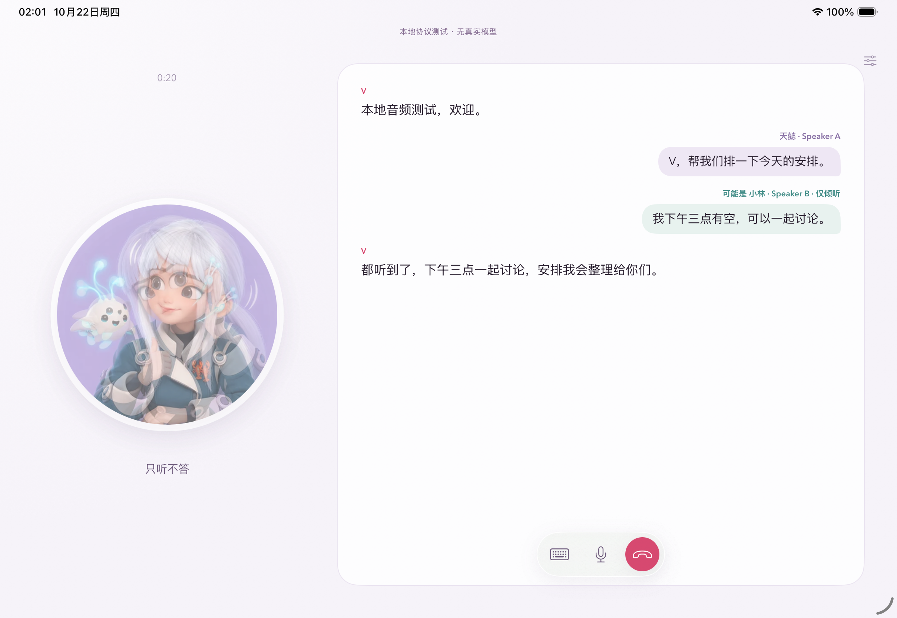

# 当前验证记录 · 2026-10-21

源基线：`origin/main 77fb188ccdc976126a6098b8d218957cc28bad82`，其中正式 Voice 运行登记为 `16932ca42f415c8b0e93c5886b61cb571de4a7d3`。本分支没有改动后端。原生代码提交：`5030248ad33c44c1bea24d95e4dd82f06ca6696e`。

环境：Xcode 27.1 / 27A9275；iPhone 17 Pro 模拟器 iOS 26.5。首轮核对时物理 iPhone 17 Pro 为 unavailable；后续已通过 USB 连接，实测系统为 iOS 27.0.1、开发者模式 enabled、配对和 tunnel 正常。用户已完成 Xcode Apple Account 登录及团队协议处理；Release 开发签名、IPA 导出、主 App 与扩展签名校验、USB 真机安装均已成功。真实通话和操作按钮接受仍待实际完成。Keychain 测试使用正常签名的模拟器包；禁用模拟器签名时的 Keychain 失败不被当作通过。

## 已通过

| 检查 | 结果与实际范围 |
|---|---|
| Swift 核心测试 | 3/3：个人 URL 不带入客户端身份参数；重复动作／晚到旧 generation；播放清空后旧 completion 不消耗新回答及 sequence 去重／溢出。 |
| 原生 App 集成 | 11/11：未绑定不能开麦；Keychain 重开及 DeviceOnly 属性；早到音频有界等待；建连中挂断；静音跨恢复；自然挂断；provider 恢复；真实 AVAudioEngine 采集、PCM WebSocket 上传、多轮播放、静音、重复动作、重拨；结果接收及清空；socket 恢复不重复欢迎语；合成系统打断恢复。 |
| 后端合同 | 79/79，原有 `hosted.test.mjs` + `session.test.mjs`，覆盖入口／cookie／会话归属／工具与既有生命周期；没有调用真实模型。 |
| 系统 UI 实操 | 在 Codex 内置浏览器镜像实际模拟器：App 呼叫、系统麦克风拒绝后的设置入口、后台收起灵动岛、长按展开、灵动岛静音、灵动岛结束；锁屏活动与结束。不是静态 SwiftUI Preview。 |
| 后台与锁屏音频 | 退出 App 后和锁屏期间，本地 fixture 的 inputBytes／heartbeat 持续增长；锁屏点结束后 active=null、音频输入计数停止。fixture 仅统计输入字节，不保存录音。 |
| Release 编译 | arm64 Release archive 成功，主 App 和 Activity 扩展齐全。正常 HTTPS/TLS、4 个系统 intents 元数据正确，AudioRecording 与 SessionStarting traits 存在；本地 Debug 入口与 fixture-cookie 不在 Release 可执行文件中。 |
| 签名导出及安装 | 已通过。Release 1.0.0 (1) 开发签名归档、IPA 导出成功，主 App 与 Activity 扩展的 profiles 齐全，codesign deep/strict 校验通过。devicectl 已实际安装到用户指定的 iPhone 17 Pro（iOS 27.0.1）。 |

原生测试结果：XcodeBuildMCP `test_sim_2026-10-21T10-24-55-960Z`，11 passed / 0 failed / 0 skipped。结果保存在本机 XcodeBuildMCP result bundle，不将测试日志／数据库提交到 Git。

运行期间发现并修复：Swift 6 让未标 Sendable 的音频 tap 回调继承主线程隔离而崩溃；后续轮次播放状态不更新；旧回调干扰新播放；静音恢复前可能短暂上传输入；欢迎语早于音频初始化到达。真机 Voice Processing I/O 与模拟器 HAL 不同，模拟器明确绕过 VPIO，不伪装为已验证真机 AEC。

仍有 Xcode 运行时的短暂 QoS priority inversion 提示，出现在音频引擎启停路径，没有被当作零性能风险；需要在真机通话时检查连接／恢复是否有可感知卡顿。未发现本轮回归的功能失败。

## 实际画面

以下均是本地无模型协议服务，不能当作和真实 V 通话或真人音频听验的证明。

## 尚未通过的门槛

1. 完整的 [真机接受矩阵](ACCEPTANCE.md)，尤其操作按钮、锁屏冷启动、强退后恢复、真实音频／插话、耳机、系统来电和蜂窝切换。
2. 使用本人的真实入口走一次原生 App → 现有 V 服务 → 真实工具／后台任务的授权验收。

没有合并、没有部署 Voice、没有重启 Gateway、没有上架 App。网页首页与正式发布登记保持原版本事实。

前次签名接入复核：2026-10-21 18:26（Asia/Shanghai），执行实际 development 归档脚本仍返回 No Accounts / 缺少主 App 与扩展 profiles；物理 iPhone 仍为 unavailable。可重复检查的未签名产物位于本机 `ios/build/VVoice-5030248-unsigned.xcarchive`，其检查结果 signed=false、profilesPresent=false。未生成或宣称可安装 IPA。

真机接入后续：用户指定使用 Tianyi iPhone 17 Pro。设备现已连接（iOS 27.0.1），额外模拟器下载已跳过，用户已在构建所用 Xcode 27.1 完成 Apple Account 登录／验证；重新执行签名安装脚本后，Apple 返回 PLA Update available。当前必须由团队 Account Holder 在 Apple Developer 接受最新协议后才能继续生成 profiles。只记录设备型号和系统版本，不提交 UDID、账号或凭据。

签名安装后续：团队协议处理后，第一次归档遇到 Xcode 新 profile 文件尚未落盘的问题；重新生成归档后成功。最终脚本退出 0，archive 和 export 均 SUCCEEDED，verify-release 返回 signed=true、profilesPresent=true，devicectl 返回 App installed。签名产物保存在本机 `ios/build/VVoice.xcarchive` 和 `ios/build/export/VVoice.ipa`，均不提交 Git。

导出的 IPA 已另行解包，再次通过签名、主 App／扩展 profiles、arm64、系统 intents 和 Release TLS／无 Debug fixture 校验。首次 devicectl 前台启动被系统 Locked 拒绝；已请用户解锁并本人打开 App、绑定入口及授权麦克风。不能将安装成功记为首次启动或真实通话通过。

## 真机音频启动修复 · build 2

用户已绑定入口，但首次拨号显示“音频暂不可用”。使用同一台 iPhone 17 Pro 单独运行无网络音频自检，旧实现可稳定复现：麦克风格式为 48 kHz、输出端为 44.1 kHz，引擎 start 返回后、第一帧 PCM 之前立即停止。只提前创建输入／输出节点而仍沿用 44.1 kHz 输出也失败，不能作为修复。

最终将主混音器到输出节点的格式显式设为输入节点的协商格式；网络／播放器仍为 24 kHz，由混音器转换，真机保留 Voice Processing I/O。Apple SDK `AVAudioIONode.h` 也明确要求 voice-processing 的输入节点输出格式与输出节点输入格式相同。另修复每个新 relay 必须重置播放序号：跨通话保留旧 sequence 会丢掉重拨／恢复后的前几段音频，同时保持旧 epoch completion 无效。

真机 `DeviceAudioTests.testAudioCapturesPlaysAndRestartsWithoutNetwork` 已通过：连续 3 次启动、收到实际 PCM、静音合成 PCM 播放完成、停止后输入不再增长；没有网络、模型调用或录音落盘。结果保存在本机 `ios/build/device-audio-fixed.xcresult`。这是硬件采集／播放管线验证，不能代替真实模型双向对话和真人听感验收。

更新后的模拟器 12/12 原生测试通过，包含重拨欢迎语确实进入播放、socket 恢复后新音频确实播放。完整回归脚本退出 0：Core 4/4、模拟器原生 12/12、原有服务合同 79/79；其中 Core 新增新 relay 序号与旧回调隔离回归。修复提交 `f8da9e8`，Release 1.0.0 (2) 已开发签名、导出 IPA 并实际安装到同一台手机；导出的 IPA 独立解包后也通过全部发布包检查。安装后 devicectl 前台启动被系统 Locked 拒绝，已请用户解锁后本人重试真实通话。

用户真机复测：Tianyi 在同一台 iPhone 17 Pro 的 build 2 上明确确认“已接通，能双向对话”。据此将基本真实服务连接及双向语音记为用户实测通过；未据此推断具体模型、持续 10 分钟、打断质量、操作按钮、锁屏冷启动、耳机或真实工具链路已通过。下一项等待用户实际验证操作按钮和锁屏／灵动岛控制。

## 系统通话入口与错误分类修复 · build 3

用户在旧 App Intent 路径遇到动态前台“解锁并继续”弹窗，以及没有通话时提示占用。现场查询时 releaseReadiness 的活动通话、建连和后台任务均为 0；近十分钟恰有 6 次呼叫，已达既有服务的每 IP 十分钟 6 次限额。客户端将 429 与 409 全映射 busy，会把频率限制误报为通话占用。没有通过额外正式拨号探测限流，也没有清空生产会话或重启服务。

本版区分 rateLimited 与 busy；失败清理使用有限后台清理时间，重试／重新绑定等待归属关闭完成。麦克风与系统音频激活前不再创建远端会话，避免一次前台继续消耗第二次拨号额度。模拟器新增“429 不误报另一通电话且不自动重拨”“失败后立即重试等待归属清理”回归。

CallKit 配置 audio + voip 模式，等待系统 didActivate 再启用音频；真机前台系统音频接管和原三轮采集／播放自检已通过。普通后台测试的事务被系统以 invalidAction 拒绝，不当作支持后台通话的证据。本版以 SiriKit INStartCallIntent + CallKit 实现真正系统外呼上下文，通过系统 UI 添加「灵动岛拨给 V」快捷指令；不将前台 immediate 或打开主 App 自动拨号作为替代方案。接收者固定为 V，只调用本机已绑定的原服务身份。Siri 权限、系统通话 intent 声明和签名 entitlement 纳入发布包检查。

Siri 通话快捷指令可创建，非法接收者／视频拒绝的两项集成测试通过；完整脚本 Core 5/5、原生 16 passed + 1 仅真机 CallKit 测试在模拟器 skipped、服务合同 79/79。系统通话 handoff、解锁／锁屏按键和仅灵动岛通话必须继续真机接受，不能以这些自动测试替代。运行时只在本机有界保存 80 条生命周期事件与错误类别，不保存入口、cookie、PCM、联系人资料或聊天文本。

新增设置按钮已在 Codex 内置浏览器的真实模拟器镜像中检查，系统“添加到 Siri”控件实际显示。没有把模拟器的快捷指令可创建或 CallKit 前台测试当作锁屏／冷启动／仅灵动岛验收。

发布包注册复核：最终候选使用 build 4，根 Info.plist 以 `INIntentsSupported` 注册 App 内 SiriKit handler（不是扩展的 IntentsSupported 键）；NSUserActivityTypes 注册通话 handoff，未列入锁屏受限列表。新增读取真实测试宿主 Bundle Info 的集成检查，SiriKit 三项测试 3/3。快捷指令专用操作不要求额外 Siri 语音授权；这不代表已完成锁屏实际拨号。

build 4（代码 `cd9954f`，系统通话实现 `498e596`）开发签名、归档、IPA 导出和 USB 实机安装成功。导出 IPA 单独解包后验证主 App／扩展签名与 profiles、Siri entitlement、INIntentsSupported 与 UserActivity 注册、旧 App Intent 保持 background 模式、正常 TLS 和无 Debug fixture。已请用户仅在一次配置时使用设置中的系统按钮添加「灵动岛拨给 V」，替换旧的普通 App 动作；退出 App 后的实际操作按钮／仅灵动岛通话仍等待用户确认，不记为通过。

## 恢复原后台灵动岛路径 · build 5 · 2026-10-22

用户实测 build 4 仍会打开主 App，明确拒绝此交互，并补充此前 build 2 已能在灵动岛对话；“需要解锁”是音频错误后的错误判断。该反馈纠正了上节的路径选择，不能继续将 SiriKit 注册或前台 CallKit 自检当作用户目标的达成。

代码 `ba258a6` 恢复 `f8da9e8` 的 AudioRecordingIntent + LiveActivityIntent、原生音频初始化顺序和 ActivityKit 控件；仅允许 background、alwaysAllowed，删除音频失败后 `continueInForeground("解锁并继续…")` 及动态 foreground 模式，撤回 SiriKit / CallKit 转交、VoIP 后台模式和 Siri entitlement。通用音频错误文案也不再推断必须解锁。保留真机输入／输出格式修复、新 relay 播放序号重置、429 与 busy 区分、等待本通话归属清理后再重拨，以及不含凭据／录音／文本的本机有界生命周期记录。

本地无模型完整脚本退出 0：Core 5/5、原生 14/14、既有服务合同 79/79；恢复后的操作按钮配置说明在 Codex 内置浏览器的真实模拟器镜像中核对，系统“添加到 Siri”按钮已移除，明确选择 V Voice「和 V 通话」。最终只补充通用音频错误文案后重新 Release 编译签名，不将本地 PCM 测试记为真实服务或锁屏冷启动验收。

Release 1.0.0 (5) 已成功 development 签名归档、导出并由 devicectl 安装到同一台 iPhone 17 Pro。最终 IPA 独立解包后再次通过 codesign deep/strict、主 App／活动扩展 profiles、arm64、后台 intent 元数据、无 Siri entitlement、正常 TLS 与无 Debug fixture 检查。build 5 的操作按钮／仅灵动岛双向对话等待用户在桌面手动验证；若曾选用「灵动岛拨给 V」，需在系统操作按钮设置改回「和 V 通话」。原 Keychain 绑定保留，未卸载、未发起真实付费电话、未修改或部署正式服务。

用户真机接受 · 2026-10-22：针对 build 5「改回和 V 通话、返回桌面、长按操作按钮说话」的复测，Tianyi 明确确认“留在灵动岛，双向对话正常”。据此将操作按钮从桌面启动、没有打开主 App、灵动岛内基本真实双向通话记为用户实测通过。锁屏冷启动、系统结束／手动强退后启动、长时间通话、系统来电及耳机／网络切换仍未包含在本次确认范围。

## H5 原生界面与灵动岛方案 · build 6 · 2026-10-22

当前 H5 源与已登记的 main 页面相同；未修改 H5／Voice 服务端。原头像、薰衣草背景、玫红拨号键、模型选择、通话控制胶囊、当前／全部对话与方案阅读转为原生 SwiftUI。宽屏沿用 H5 701 pt 断点与双栏，启用 iPhone／iPad family，iPad 支持横竖屏。同步脚本记录公开视觉源的 SHA256 并可 --check，避免两端素材和 GFM lexer 漂移。

灵动岛新增有界最近一句话、任务阶段、未读方案卡；深链只打开当前通话内对应内容，不会因读取参数重新拨号。没有收到方案时不显示虚构按钮；后台收到不确认已看，原生正文进入视图后才确认，读后清除未读标记并恢复对话。最多 84 字短句，删除 URL；锁屏内容标记 privacySensitive，设置中可关闭摘要。Activity 内容 JSON 的实际测试值低于 4 KB。没有发送完整正文、入口、cookie 或工具身份到活动。

UI 实操发现原 20 帧（400 ms）主线程交接阈值，在从后台切到阅读界面时会触发 capture overflow。初期 WebView 阅读器已撤回；最终 GFM lexer 通过 JavaScriptCore 在非主线程解析，界面全部原生绘制。交接上限设为 64 个 20 ms 帧（1.28 秒／约 61 KB），仍低于上传的 96 KB 上限；持续积压仍明确失败，未增加无界缓冲或修改录音启动权限／流程。新增 700 ms 主线程暂停的真实采集回归及录音期间实际创建阅读器的回归。实际失败类别只记录 capture/upload-overflow，不含音频／正文。

最终原生回归 20/20，核心 8/8；既有服务合同 79/79。全部使用本地无模型 fixture。实际模拟器路径：从主 App 拨号 → 桌面 → 后台送达方案 → 长按灵动岛 → 点方案 → 原生表格／正文与底部通话控制 → 回桌面 → 灵动岛最近一句话 → 灵动岛结束。修复后读取期间原 voiceSession 保持、输入字节继续增长，仅原生显示后收到一次 content-shown，结束后无活动会话。iPad Pro 11 英寸 iOS 26.5 模拟器实际检查竖屏、横屏双栏及结束控件。

代码提交 `329bc3b`，Release 1.0.0 (6) development 签名归档及导出成功，独立 IPA 解包后通过主 App／扩展签名与 profiles、arm64、H5 源 CSS 一致性、iPhone／iPad family、后台 TalkToVIntent 元数据、正常 TLS 及无 Debug fixture 检查。安装前状态只读确认 activeCalls=0、creatingSessions=0、backgroundTasks=0；随后 devicectl 已安装到 Tianyi 的同一台 iPhone 17 Pro。原绑定保留，未自动发起真实通话；已请用户在原操作按钮入口复测。build 5 的签名回滚包保存在本机 `ios/build/VVoice.xcarchive.previous-20261022-005206`。没有调用正式模型，没有修改正式服务／Gateway、合并或推送；build 5 的真机基本按键通话已获用户接受，build 6 的视觉与真实工具方案路径仍需人类实测。

## 完整 H5 Reaction 补齐 · build 7 · 2026-10-22

用户追问后核对，build 6 确实只有 7 张基础状态图；此前“对齐 H5”未包含完整 Reaction，现明确纠正。build 7 从 AVATAR_CATALOG / AVATAR_SEQUENCES 导入全部 52 个图库条目及原 continuations；源图片和语义目录纳入同一 SHA256 同步检查，移除旧的重复基础图别名。

新增原生 VoiceAvatar：使用既有 /api/avatar 与本通话 cookie／voiceSessionId，最多 6 段上下文、每段最多 600 UTF-16 单元；400 ms 去抖，完整助手短语触发且后续语义至少间隔 6 秒；新用户语义淘汰旧结果，助手动作保留至少 1.6 秒。Decision 仅控制展示，不能授权工具或影响录音。只在 App 前台、头像可见且未被方案／设置遮盖时请求；3.5 秒超时独立于语音，失败保持安全姿态。

姿态只在当前 Decision 批准的主图／后续图内轮换，没有批准后续时使用倾听安全对；同一 anchor 不重置停留期限，约 4.3 秒换姿态（低于 H5 5 秒上限），280 ms 渐变、遵循减少动态效果。真实原生头像进入视图显示周期后才记录 displayed；沿用既有有界 avatar-events 协议，单批最多 20 个、20 KB，未写入 Git 日志或个人文本。

原生回归 23/23：包括全 52 张资源可载入／15 张情绪图及全部后续引用有效、批准后续切换、遮盖不请求、晚到旧语义不能覆盖新语义，以及 build 6 的持续录音／方案等既有回归。H5 原 Reaction 测试 26/26。实际模拟器 mock 链路显示 reaction-0、reaction-1、listen-5；displayed 记录与实际照片切换一致，通话持续且结束后 active=null。没有调用正式分类器或真实模型，不以此声称手机真实语义效果已验收。

代码 `3b4efbd`，Release 1.0.0 (7) 开发签名归档及导出成功，独立 IPA 解包检查签名／profiles、52 个完整目录及有效后续引用、H5 CSS、后台按键元数据和无 Debug fixture 均通过。安装前只读状态 activeCalls=0、creatingSessions=0、backgroundTasks=0；devicectl 已实际安装到同一台 iPhone 17 Pro，原绑定与按键配置保留。Voice 后端／Gateway／Worker 和按键后台入口均未改。

## H5 全面迁移复查 · build 8 · 2026-10-22

结论与逐项差异见 [H5-PARITY.md](H5-PARITY.md)。本轮明确纠正 build 6/7 “界面对齐”容易被误解为完整功能迁移的问题：人类／多人事件、连续发言、身份、富文本和声音试听此前确实有遗漏。GPT Live 原生传输、灵动岛新设计、真实多人质量仍没有验收通过。

实际验证：

- Core 10/10；原生 28/28（0 skipped），包含真实模拟器录音／播放／静音／重复触发／重拨、speaker relay 两人转写与决策更新、ASR 恢复时收音继续、无重复 provider 字幕、Grok voice session 请求、长回复卡片与正确回执归属、已有样本播放→正式通话音频接管。既有服务回归 79/79。本地 fixture 无模型、无工具执行，仅统计输入字节，不保存录音。
- 原生首轮新增 speaker 用例把欢迎语尚在播放的短暂 listening 当作已播完，测试暴露了该竞态；改为等待第一次真实播放并回到 listening，再发送多人事件。也把每次输出开始时清除仅倾听状态明确放到播放回调。最终全套通过。
- 长回复变为阅读卡片后，复查发现它可能被错误排除于 Reaction 上下文；保留原文行后修正该过滤。增加上下文必须含该长回复的断言，定向重跑 1/1 通过。最后 UI 文案／滚动微调与该修复也重新编译并用真实模拟器核对。
- `sync-h5-design.mjs --check` 通过；52 图和 continuation 仍完整，新增 H5 更新日志同源 JSON。Release 验包再次比对拥有源。
- 在右侧内置浏览器通过 serve-sim 看到真实 iPhone 17 Pro iOS 26.5：两个不同身份气泡、可能姓名、五色中的两色、仅倾听、同一轮 V 回复、头像收缩与全部入口；实际进入声音试听并切换盲听；后台方案到达前台时展开表格／列表方案且控制条保留。
- iPad Pro 11 M5 iOS 26.5 横屏安装同一 Debug build 8，在相同镜像里实际看到头像／聊天双栏与两人文字。增加多轮示例，上翻后再发两次 assistant partial；视口仍停在早期发言，未跳回最新字幕。
- 结束两台模拟器的 fixture 通话，确认 active=false；iPhone 方案的真实 content-shown 回执计数为 1。保留镜像供查看，不将运行日志、私人入口或设备标识提交。
- Development-signed Release 1.0.0 (8) archive 与 IPA 导出成功，解压导出 IPA 后独立验包成功：arm64、主 App／扩展 profiles 齐全、deep/strict 签名通过、正常 TLS、Debug fixture 不在 Release。TalkToVIntent 的 openAppWhenRun=false、background、AudioRecording／SessionStarting traits 仍正确；`VoiceIntents.swift`、`VoiceAudio.swift`、`RelayTransport.swift`、`VoiceWidget.swift` 相对 build 7 无改动。
- 安装前只读状态确认 activeCalls=0、creatingSessions=0、backgroundTasks=0；devicectl 成功覆盖安装 build 8 到用户指定 iPhone 17 Pro。保留本机绑定和权限，没有自动启动真实通话、调用模型、改后端或重启 Gateway。
- 导出 IPA SHA-256：`a3393b1a9227f1472d50140b5948e714bd3614a41f70e1a551897387ae3f0bab`。归档脚本保留前版签名 archive，仍可覆盖回滚；本机安装／解压产物在 ignored ios/build。

真机状态只算**已安装**。build 5 的操作按钮后台双向通话是历史人工接受；不把它自动扩展为 build 8 的多人识别、实际媒体音频、真实声音试听、锁屏和长通话功耗接受。

