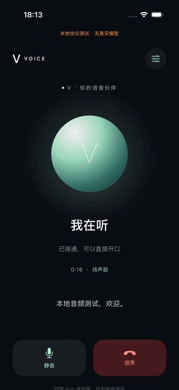
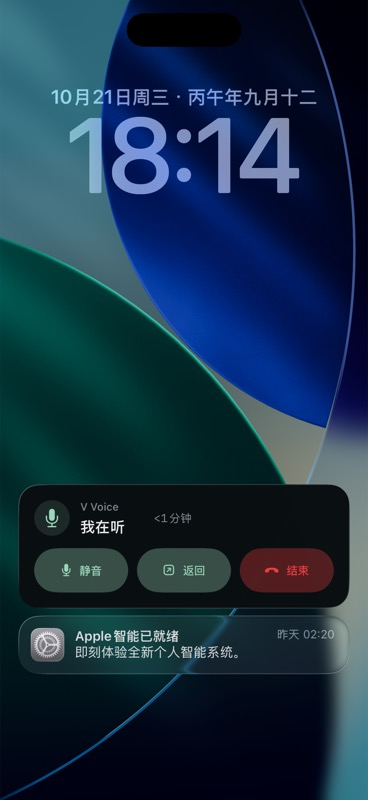

# 当前验证记录 · 2026-10-21

源基线：`origin/main 77fb188ccdc976126a6098b8d218957cc28bad82`，其中正式 Voice 运行登记为 `16932ca42f415c8b0e93c5886b61cb571de4a7d3`。本分支没有改动后端。原生代码提交：`5030248ad33c44c1bea24d95e4dd82f06ca6696e`。

环境：Xcode 27.1 / 27A9275；iPhone 17 Pro 模拟器 iOS 26.5。首轮核对时物理 iPhone 17 Pro 为 unavailable；后续已通过 USB 连接，实测系统为 iOS 27.0.1、开发者模式 enabled、配对和 tunnel 正常。用户已完成 Xcode Apple Account 登录及团队协议处理；Release 开发签名、IPA 导出、主 App 与扩展签名校验、USB 真机安装均已成功。真实通话和操作按钮接受仍待实际完成。Keychain 测试使用正常签名的模拟器包；禁用模拟器签名时的 Keychain 失败不被当作通过。

## 已通过

| 检查 | 结果与实际范围 |
|---|---|
| Swift 核心测试 | 3/3：个人 URL 不带入客户端身份参数；重复动作／晚到旧 generation；播放清空后旧 completion 不消耗新回答及 sequence 去重／溢出。 |
| 原生 App 集成 | 11/11：未绑定不能开麦；Keychain 重开及 DeviceOnly 属性；早到音频有界等待；建连中挂断；静音跨恢复；自然挂断；provider 恢复；真实 AVAudioEngine 采集、PCM WebSocket 上传、多轮播放、静音、重复动作、重拨；结果接收及清空；socket 恢复不重复欢迎语；合成系统打断恢复。 |
| 后端合同 | 79/79，原有 `hosted.test.mjs` + `session.test.mjs`，覆盖入口／cookie／会话归属／工具与既有生命周期；没有调用真实模型。 |
| 系统 UI 实操 | 在 Codex 内置浏览器镜像实际模拟器：App 呼叫、系统麦克风拒绝后的设置入口、后台收起灵动岛、长按展开、灵动岛静音、灵动岛结束；锁屏活动与结束。不是静态 SwiftUI Preview。 |
| 后台与锁屏音频 | 退出 App 后和锁屏期间，本地 fixture 的 inputBytes／heartbeat 持续增长；锁屏点结束后 active=null、音频输入计数停止。fixture 仅统计输入字节，不保存录音。 |
| Release 编译 | arm64 Release archive 成功，主 App 和 Activity 扩展齐全。正常 HTTPS/TLS、4 个系统 intents 元数据正确，AudioRecording 与 SessionStarting traits 存在；本地 Debug 入口与 fixture-cookie 不在 Release 可执行文件中。 |
| 签名导出及安装 | 已通过。Release 1.0.0 (1) 开发签名归档、IPA 导出成功，主 App 与 Activity 扩展的 profiles 齐全，codesign deep/strict 校验通过。devicectl 已实际安装到用户指定的 iPhone 17 Pro（iOS 27.0.1）。 |

原生测试结果：XcodeBuildMCP `test_sim_2026-10-21T10-24-55-960Z`，11 passed / 0 failed / 0 skipped。结果保存在本机 XcodeBuildMCP result bundle，不将测试日志／数据库提交到 Git。

运行期间发现并修复：Swift 6 让未标 Sendable 的音频 tap 回调继承主线程隔离而崩溃；后续轮次播放状态不更新；旧回调干扰新播放；静音恢复前可能短暂上传输入；欢迎语早于音频初始化到达。真机 Voice Processing I/O 与模拟器 HAL 不同，模拟器明确绕过 VPIO，不伪装为已验证真机 AEC。

仍有 Xcode 运行时的短暂 QoS priority inversion 提示，出现在音频引擎启停路径，没有被当作零性能风险；需要在真机通话时检查连接／恢复是否有可感知卡顿。未发现本轮回归的功能失败。

## 实际画面

以下均是本地无模型协议服务，不能当作和真实 V 通话或真人音频听验的证明。

## 尚未通过的门槛

1. 完整的 [真机接受矩阵](ACCEPTANCE.md)，尤其操作按钮、锁屏冷启动、强退后恢复、真实音频／插话、耳机、系统来电和蜂窝切换。
2. 使用本人的真实入口走一次原生 App → 现有 V 服务 → 真实工具／后台任务的授权验收。

没有合并、没有部署 Voice、没有重启 Gateway、没有上架 App。网页首页与正式发布登记保持原版本事实。

前次签名接入复核：2026-10-21 18:26（Asia/Shanghai），执行实际 development 归档脚本仍返回 No Accounts / 缺少主 App 与扩展 profiles；物理 iPhone 仍为 unavailable。可重复检查的未签名产物位于本机 `ios/build/VVoice-5030248-unsigned.xcarchive`，其检查结果 signed=false、profilesPresent=false。未生成或宣称可安装 IPA。

真机接入后续：用户指定使用 Tianyi iPhone 17 Pro。设备现已连接（iOS 27.0.1），额外模拟器下载已跳过，用户已在构建所用 Xcode 27.1 完成 Apple Account 登录／验证；重新执行签名安装脚本后，Apple 返回 PLA Update available。当前必须由团队 Account Holder 在 Apple Developer 接受最新协议后才能继续生成 profiles。只记录设备型号和系统版本，不提交 UDID、账号或凭据。

签名安装后续：团队协议处理后，第一次归档遇到 Xcode 新 profile 文件尚未落盘的问题；重新生成归档后成功。最终脚本退出 0，archive 和 export 均 SUCCEEDED，verify-release 返回 signed=true、profilesPresent=true，devicectl 返回 App installed。签名产物保存在本机 `ios/build/VVoice.xcarchive` 和 `ios/build/export/VVoice.ipa`，均不提交 Git。

导出的 IPA 已另行解包，再次通过签名、主 App／扩展 profiles、arm64、系统 intents 和 Release TLS／无 Debug fixture 校验。首次 devicectl 前台启动被系统 Locked 拒绝；已请用户解锁并本人打开 App、绑定入口及授权麦克风。不能将安装成功记为首次启动或真实通话通过。

## 真机音频启动修复 · build 2

用户已绑定入口，但首次拨号显示“音频暂不可用”。使用同一台 iPhone 17 Pro 单独运行无网络音频自检，旧实现可稳定复现：麦克风格式为 48 kHz、输出端为 44.1 kHz，引擎 start 返回后、第一帧 PCM 之前立即停止。只提前创建输入／输出节点而仍沿用 44.1 kHz 输出也失败，不能作为修复。

最终将主混音器到输出节点的格式显式设为输入节点的协商格式；网络／播放器仍为 24 kHz，由混音器转换，真机保留 Voice Processing I/O。Apple SDK `AVAudioIONode.h` 也明确要求 voice-processing 的输入节点输出格式与输出节点输入格式相同。另修复每个新 relay 必须重置播放序号：跨通话保留旧 sequence 会丢掉重拨／恢复后的前几段音频，同时保持旧 epoch completion 无效。

真机 `DeviceAudioTests.testAudioCapturesPlaysAndRestartsWithoutNetwork` 已通过：连续 3 次启动、收到实际 PCM、静音合成 PCM 播放完成、停止后输入不再增长；没有网络、模型调用或录音落盘。结果保存在本机 `ios/build/device-audio-fixed.xcresult`。这是硬件采集／播放管线验证，不能代替真实模型双向对话和真人听感验收。

更新后的模拟器 12/12 原生测试通过，包含重拨欢迎语确实进入播放、socket 恢复后新音频确实播放。完整回归脚本退出 0：Core 4/4、模拟器原生 12/12、原有服务合同 79/79；其中 Core 新增新 relay 序号与旧回调隔离回归。修复提交 `f8da9e8`，Release 1.0.0 (2) 已开发签名、导出 IPA 并实际安装到同一台手机；导出的 IPA 独立解包后也通过全部发布包检查。安装后 devicectl 前台启动被系统 Locked 拒绝，已请用户解锁后本人重试真实通话。

用户真机复测：Tianyi 在同一台 iPhone 17 Pro 的 build 2 上明确确认“已接通，能双向对话”。据此将基本真实服务连接及双向语音记为用户实测通过；未据此推断具体模型、持续 10 分钟、打断质量、操作按钮、锁屏冷启动、耳机或真实工具链路已通过。下一项等待用户实际验证操作按钮和锁屏／灵动岛控制。

## 系统通话入口与错误分类修复 · build 3

用户在旧 App Intent 路径遇到动态前台“解锁并继续”弹窗，以及没有通话时提示占用。现场查询时 releaseReadiness 的活动通话、建连和后台任务均为 0；近十分钟恰有 6 次呼叫，已达既有服务的每 IP 十分钟 6 次限额。客户端将 429 与 409 全映射 busy，会把频率限制误报为通话占用。没有通过额外正式拨号探测限流，也没有清空生产会话或重启服务。

本版区分 rateLimited 与 busy；失败清理使用有限后台清理时间，重试／重新绑定等待归属关闭完成。麦克风与系统音频激活前不再创建远端会话，避免一次前台继续消耗第二次拨号额度。模拟器新增“429 不误报另一通电话且不自动重拨”“失败后立即重试等待归属清理”回归。

CallKit 配置 audio + voip 模式，等待系统 didActivate 再启用音频；真机前台系统音频接管和原三轮采集／播放自检已通过。普通后台测试的事务被系统以 invalidAction 拒绝，不当作支持后台通话的证据。本版以 SiriKit INStartCallIntent + CallKit 实现真正系统外呼上下文，通过系统 UI 添加「灵动岛拨给 V」快捷指令；不将前台 immediate 或打开主 App 自动拨号作为替代方案。接收者固定为 V，只调用本机已绑定的原服务身份。Siri 权限、系统通话 intent 声明和签名 entitlement 纳入发布包检查。

Siri 通话快捷指令可创建，非法接收者／视频拒绝的两项集成测试通过；完整脚本 Core 5/5、原生 16 passed + 1 仅真机 CallKit 测试在模拟器 skipped、服务合同 79/79。系统通话 handoff、解锁／锁屏按键和仅灵动岛通话必须继续真机接受，不能以这些自动测试替代。运行时只在本机有界保存 80 条生命周期事件与错误类别，不保存入口、cookie、PCM、联系人资料或聊天文本。

新增设置按钮已在 Codex 内置浏览器的真实模拟器镜像中检查，系统“添加到 Siri”控件实际显示。没有把模拟器的快捷指令可创建或 CallKit 前台测试当作锁屏／冷启动／仅灵动岛验收。
