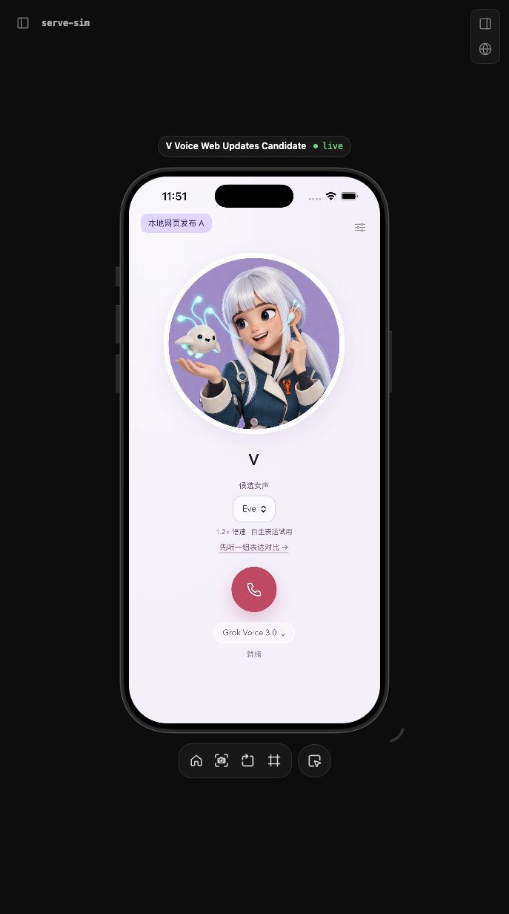
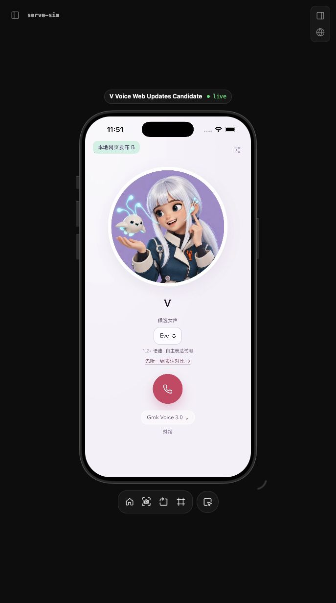

# 网页发布同步到 iOS

2026-10-22，从已合入 main 的 `68ebcc9` 开始开发，随后重放到包含 build 11 交付登记的 `f1f76a3`。此候选需要一次原生壳升级；现有 build 11 仍只读包内快照。用户已授权合入、发布和保留绑定的真机升级。PR #58 已合入，正式服务与 build 12 已交付，真机网页资源 ready 握手通过；麦克风双向对话验收失败，build 13 诊断候选排查中。当前状态以 [发布登记](../releases/voice-ios-web-delivery-20261022/README.md) 为准。以下保留方案及候选验证范围。

## 方案与实际代码依据

只读核对了本机 Makaron 当前代码：`capacitor.config.ts` 和 `ios/App/App/capacitor.config.json` 都没有生产 `server.url`，实际入口是 `capacitor-www/index.html` 的包内启动页，探测后 `location.replace('https://www.makaron.app/home')`；原生能力由 `MakaronBridgeViewController.swift` 和 Capacitor 插件提供。因而 Makaron 的托管页面可以随网页部署更新，Swift/插件仍要重新打包。

V Voice 当前的 `CallCoordinator` / `VoiceAudio` 和 AudioRecordingIntent / LiveActivityIntent 是唯一通话 owner。普通 H5 的 `app.js` 会自己建立音频/会话，直接跳转到该页面会引入第二条通话路径。因此采用**网页发布携带完整 iOS 界面资源包，App 原生下载、校验、缓存，继续从原有自定义 scheme 展示**。共享 DOM/CSS/React、Markdown/全文阅读和 Reaction 模块仍来自原 H5；`ios/H5/native-h5.mjs` 仅负责把同一界面动作转到已有窄桥接。

只涉及独立 Voice 客户端和现有服务的静态资源分发；不改 Gateway/Worker、权限、会话映射或跨服务通话协议。使用独立本地 Candidate，不占共享 VLab integration lease。

## 加载与回退

1. 启动时使用上次通过页面握手的缓存或包内快照，不等待网络。缓存按已绑定入口的 HTTPS origin/path 隔离，只有公开 UI 字节，没有入口凭据、通话正文或 session ID。
2. App 在前台且没有通话时，从已绑定 baseURL 的 `ios-shell-release.json` 检查更新；每个 host 最多每 10 分钟检查一次，没有后台轮询。新 host/下次启动会再次检查。下载不携带 Cookie/Authorization，不刷新绑定，不跟随任何重定向；Release 只允许 HTTPS，Debug 另允许本地 loopback fixture。
3. 资源包 schema 1 声明支持的 bridge 范围，目前为 1。原生同时校验逐文件 SHA-256、长度、完整资源 revision、必需文件、路径白名单与大小上限。最多 128 文件、单文件 2 MiB、解码总量 8 MiB、下载 12 MiB；系统下载任务超限取消，下载/校验失败保留当前界面。
4. 整包原子缓存，页面及其所有子资源固定同一 release。只有空闲、可见、没有阅读全文/试听页时才能切换。拨号后取消更新检查；通话中到达的新包只暂存，挂断并回到可见主页后使用。界面重载也沿用当前资源和原生通话 owner，不调用拨号、关闭或重新绑定。
5. 页面启动携带 bridgeVersion 握手，8 秒内未完成、桥接版本不符或 WebContent 进程终止时，回退到上次成功版本，再到包内快照。远程包在握手前不是已验证版本；进程在首次握手前异常退出，下次启动隔离该包。最多保留两个成功版本和一个候选；失败 revision 记在本机，修复后应发布新的 revision。
6. 仍只信任 `vvoice-h5://app` 主 frame 的既有页面。每次重载生成新的页面实例 ID，退休页面的迟到命令被拒绝；当前通话动作继续检查 callID。网页拿不到任意 API、工具凭据、麦克风或新的 native 能力。

完整性哈希用于发现损坏和混包；发布信任根仍是用户已验证绑定的 HTTPS 服务，不是独立第三方签名。通话期间的资源固定意味着网页发布不会立即刷新正在使用的通话界面。缓存可由系统清理，清理后自动使用包内资源。页面握手只能验证界面已启动，不能代替新 UI 的完整体验测试。

## 一次壳升级后的日常流程

1. 修改拥有源 `lab/gpt-live-h5`（DOM/CSS、React UI、阅读器、Markdown、Reaction）；如果交互编排位于 web 专用 `app.js`，同时在 `ios/H5/native-h5.mjs` 使用现有 bridge 动作适配，不能假设浏览器音频逻辑也能直接进入原生。
2. `npm run build:ui` 会生成 React bundle，并同步包内 fallback 与 `lab/gpt-live-h5/ios-shell-release.json`。只改非 React H5 资源可运行 `npm run build:ios-shell`。这两步不编译 Swift、不生成/安装 binary。
3. 运行 `npm run check:ios-shell`、相关网页测试与隔离 WK 验证；CI 的 freshness test 会阻止网页与 iOS 界面包漂移。提交生成物和变更，经 PR 合入 main。
4. 实际发布前按仓库规则更新首页 `changelog.mjs`、CHANGELOG 和版本登记，再重新生成资源包。只记录当次真实交付内容。本次正式发布已包含首页更新条目，真人语音异常单独记录。
5. 从通过检查的 main 运行 `npm run package -- <artifact-directory>`。发布 artifact 明确携带 `ios-shell-release.json`，由现有 Voice 静态服务使用 `no-store` 返回；生产不需要 Xcode 或编译器。沿用现有 Voice 发布、等通话结束、校验原服务、保留回滚产物的流程，不重启 Gateway。
6. App 先显示缓存，空闲检查完成后自动使用新资源。验证 App 内真实可见变化、全文阅读与同一原生会话；日志/health 200 不能代替此验收。遇到异常，回滚网页发布 artifact；下次检查会取得对应旧版资源。已被客户端判定启动失败的相同 revision 不会再次尝试，需修复生成新 revision 或通过后续原生版本处理。

## 仍需 binary 的改动

| 可随网页资源发布 | 需要升级原生壳 |
| --- | --- |
| 共享页面 DOM/CSS/React、文案、既有控件交互、Markdown/全文阅读、资源与 Reaction 的网页呈现 | Swift/原生设置页、通话传输与音频引擎、AudioRecordingIntent/LiveActivityIntent、Widget/灵动岛扩展、权限/entitlements、图标、签名与最低系统版本 |
| `native-h5.mjs` 在现有 bridge 1 能力内的适配 | 新增原生 bridge 命令或改变 snapshot/权限合同，先升级兼容壳，随后才发布依赖该版本的网页资源 |

Reaction 新图片可以进入网页，但原生灵动岛自己的图片目录仍在 binary 内；不能把网页资源更新等同于更新 Widget 资源。需要新桥接时提升兼容范围；不兼容的旧壳保留最后可用界面，不能扩大权限或静默改换通话模型。

## 验证与边界

隔离模拟器 `V Voice Web Updates Candidate` 与 fixture 端口 29847。[候选登记](web-delivery-candidate.json)：43/43 原生 WK/集成、16/16 Core、657/657 网页/服务、95/95 Speaker 通过；build 12 arm64 Release 编译和结构检查通过，未签名。已从提交 `cfdacb1` 实际生成 203 文件的发布 artifact，启动该 artifact 的本地静态服务，确认资源包 HTTP 200、`no-store`，响应与源码中的完整资源包逐字节一致。未接正式模型、未操作手机、未改共享模拟器或 29837 fixture。

右侧浏览器已实际显示专用 iPhone 模拟器。同一个安装包在两次本地网页发布后显示 A/B 标签及不同配色；两次之间只重新启动 App，没有重建或安装 binary。通话中不重载、同 owner 采集连续的证据来自独立自动集成测试，不能从主页截图推断。

| 网页发布 A | 网页发布 B（同一安装包） |
| --- | --- |
|  |  |

自动验证覆盖：同一安装包取得 A/B 两次发布并显示匹配的 HTML/CSS；绑定保持、零自动拨号；通话中暂存 B 而继续 A、重载保持 owner/voiceSessionId/采集；退休页面命令被拒；损坏/不兼容/重定向/不可达端点保留好缓存；坏 JS 超时回退；离线重新创建 WK 容器读取缓存；握手前进程退出的候选被隔离。

真实 iPhone 升级、绑定保留、正式 HTTPS 资源获取及远程页面握手已通过。用户实测开场白可听见，但麦克风说话无回应，正在排查；锁屏/操作按钮/灵动岛的本版接受尚未完成。本地合成音频与 WK 测试不扩大为真人语音已接受。
