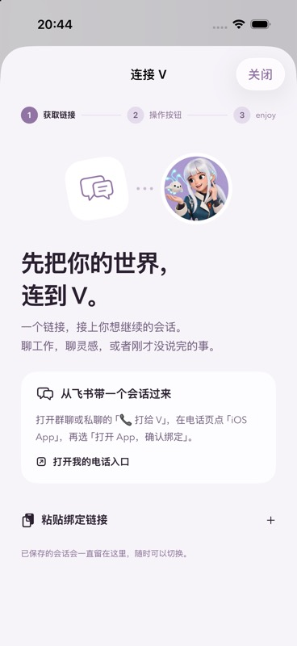
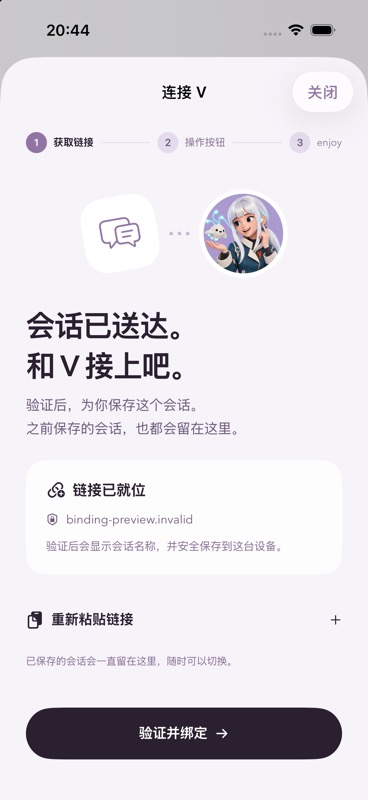
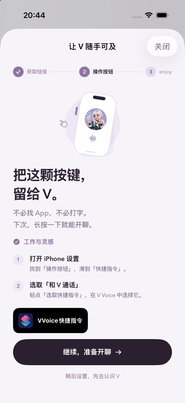
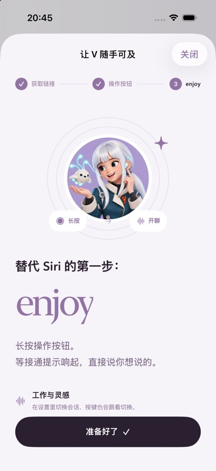
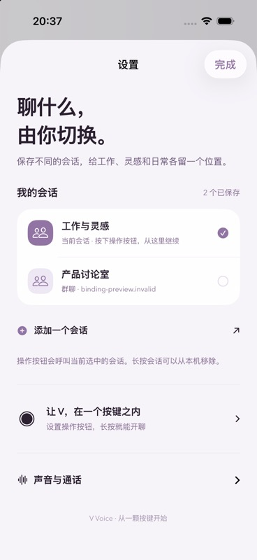

# iOS 会话绑定旅程 · build 29 整合版

未绑定时首次打开 App 自动进入三步引导；已有绑定时直接进入电话页，右上角设置管理多个会话。

1. **获取链接**：说明如何从飞书群聊/私聊的电话页取得链接。网页跳回 App 后显示「会话已送达」，展示来源域名并由用户点「验证并绑定」。链接不会自动绑定或拨号。
2. **操作按钮**：用可长按预览的 iPhone 插画与系统设置步骤说明，选择 V Voice 的「和 V 通话」。提供官方 ShortcutsLink；由用户确认完成或选择稍后设置。此确认是引导状态，不表示系统已检测到按键配置。
3. **替代 Siri 的第一步：enjoy**：展示「长按 → 开聊」，提示听到接通提示后开口，并显示绑定会话。完成后返回电话页或会话列表。

原生系统入口沿用既有 TalkToVIntent，它调用当前选中的会话。切换会话后不需要重新设置操作按钮。系统设置流程参考 [Apple 操作按钮快捷指令说明](https://support.apple.com/en-gb/guide/shortcuts/apdfea15680b/ios)。

## 多会话保存

- 同一 Keychain item 中原子保存会话集合和当前选择，继续使用 `AfterFirstUnlockThisDeviceOnly`。UI 仅接收名称、类型、域名及当前状态，不展示授权凭据。
- 旧单会话记录在读取时直接导入；保存集合时保留顶层当前记录，build 25 回退后仍能读取选中的授权。若旧版再次写入单记录，多会话历史不由旧版维护。
- 绑定和切换都先验证目标授权再提交。已经保存的目标复用设备授权，不重复兑换一次性链接。刷新一个授权不会覆盖其他已保存会话；失败保持原选择。
- 通话中禁止绑定、切换和移除。切换前完成旧通话清理，同时清空界面上旧会话的文字、文档与任务。
- 移除当前会话后保留其他记录并等待明确选择，不暗中选择另一个目标。移除是本机保存项管理；服务端设备授权仍可由网页撤销。

## 原 build 26 候选验证与边界

- Debug 模拟器构建成功；绑定/Keychain 专项 **11 passed、0 failed、1 skipped**。跳过项是已有真实绑定的共享模拟器上的“未绑定拨号拒绝”检查，避免清除其现有绑定。
- 自动测试覆盖两会话持久化、切换和去重、失效授权保留原选择、未清理通话禁止切换/移除、单项移除、旧格式导入与旧版读取当前记录。
- 专用模拟器实际完成：首次自动引导、Deep Link 填入、验证绑定、第二/三步、保存第二个会话、切换、关闭重开保持最后选择、单独移除保留另一个会话。
- UI 场景使用 opt-in Debug fixture：`--binding-journey-fixture`；`--binding-journey-reset` 只清除 fixture 的独立 Keychain service。`binding-preview.invalid` 请求由 URLProtocol 在本机响应，未发送到真实模型或生产 API。无有效录音、付费调用或真实电话验收。
- 初次正常模式运行读取原有生产绑定成功；演示使用独立 Keychain service。未安装实体手机、未发布 TestFlight、未部署服务或改动 Gateway。
- Action button 物理长按、系统设置、锁屏麦克风仍需手机验收。模拟器流程截图不能代替硬件验收。

构建与视觉使用 V Voice Session Binding Candidate 专用模拟器，其他项目的模拟器保持原样。本改动归属原生的绑定、钥匙串与系统入口设置，不改变模型/工具策略或媒体协议。

## 模拟器截图

| 首次打开 | 链接确认 |
| --- | --- |
|  |  |

| 设置操作按钮 | enjoy |
| --- | --- |
|  |  |

## build 29 与拨号加速整合

整合 main 的 build 28 单连接拨号与真实手机速度记录。每个保存会话各自持有服务端验证过的拨号能力；切换或复用已保存链接时刷新该能力，支持回退的顶层当前记录也保留它。额外回归覆盖支持/不支持快速拨号的两会话切换、重新打开后的能力保持，以及 build 28 读取选中记录。

build 29 的构建、安装与体验回执另行记录，不以旧候选版截图替代真机验收。
